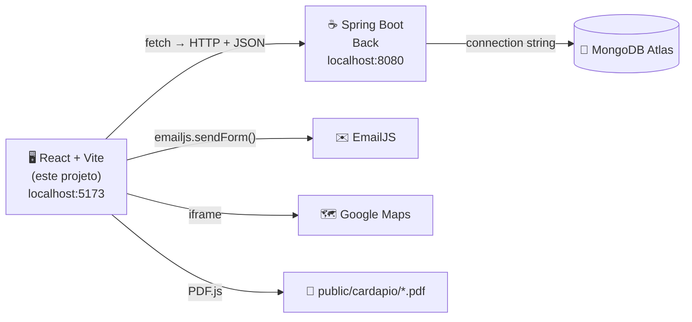
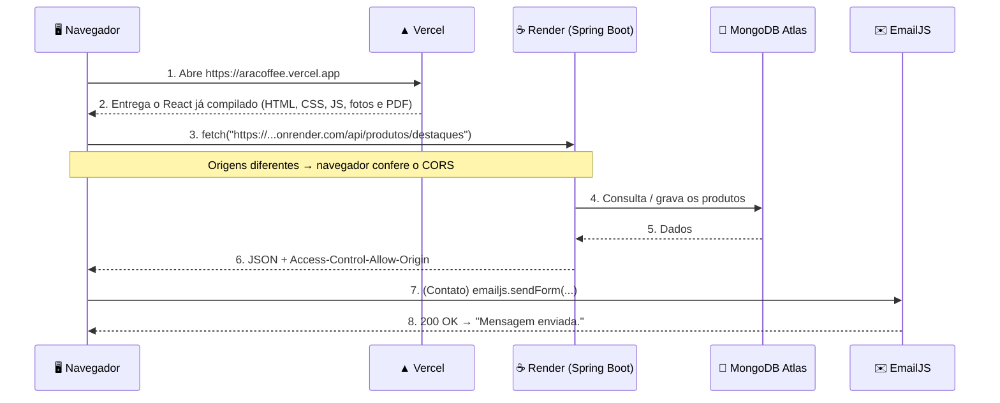

# AraCoffee Front (React + Vite + Spring Boot) ☕

      

## 📖 Descrição

Site da cafeteria **AraCoffee**, feito em **React** e **Vite**, que consome a API do projeto [**Back**](../Back) (**Spring Boot** + **MongoDB Atlas**).

| Página | Endereço | O que tem | Fala com |
| --- | --- | --- | --- |
| Início | `/` | Abertura com foto de grãos, selo da marca, **Hoje no balcão** (destaques), horário e endereço | Spring Boot |
| Cardápio | `/cardapio` | Cardápio completo com filtro por categoria e busca, no estilo "nome ........ preço" | Spring Boot |
| Cardápio impresso | `/cardapio/pdf` | A folha do balcão em PDF, lida dentro do site com o **react-pdf** (PDF.js 5) | arquivo estático |
| Contato | `/contato` | Endereço (campus Coração Eucarístico da PUC Minas), **mapa** e formulário enviado pelo **EmailJS** | EmailJS |
| Gerenciar cardápio | `/gerenciar` | CRUD completo dos produtos + painel com o status da integração | Spring Boot |

Em todas as páginas, uma **fumaça marrom** (componente **Splash Cursor** do [React Bits](https://reactbits.dev)) segue o mouse pelo fundo de grãos de café.



## 🖼️ Capturas de Tela

| Início, com a fumaça do mouse | Cardápio vindo da API |
| :---: | :---: |
|  |  |

| Cardápio impresso (react-pdf) | Contato com mapa e EmailJS |
| :---: | :---: |
|  |  |

| Editando um produto | Erro de validação vindo do Spring Boot (400) |
| :---: | :---: |
|  |  |

| Back-end desligado | Mobile |
| :---: | :---: |
|  |  |

> As capturas foram tiradas sem acesso ao Google, por isso o mapa aparece vazio no Contato. No seu navegador ele carrega normalmente.

---

## 📁 Organização das pastas (importante!)

Os scripts deste projeto sobem o back-end com `cd ../Back`. Por isso os dois projetos precisam ficar **lado a lado, dentro da mesma pasta**:

```text
📁 AraCoffee
├── 📁 Back    ← Spring Boot (porta 8080)
└── 📁 Front   ← este projeto (porta 5173)
```

## ✅ Pré-requisitos

| O quê | Para quê | Como conferir |
| --- | --- | --- |
| **Node.js 20+** | Rodar o React / Vite | `node -v` |
| **JDK 17** | Rodar o Spring Boot | `java -version` |
| **MongoDB Atlas configurado no back-end** | Gravar o cardápio | Siga a seção *Configurando o MongoDB Atlas* do [README do back-end](../Back/README.md) |
| **Conta no EmailJS** (opcional) | Enviar o formulário de Contato | Seção [Configurando o EmailJS](#-configurando-o-emailjs) |

> O Maven **não** precisa estar instalado: o back-end usa o Maven Wrapper (`mvnw`), que baixa o Maven sozinho.

---

## 🚀 Rodando os dois projetos ao mesmo tempo

### Entendendo o problema

Um terminal fica "preso" enquanto um servidor está rodando. Aqui precisamos de **dois servidores ligados ao mesmo tempo**:

| Servidor | Comando | Porta |
| --- | --- | --- |
| Back-end (Spring Boot) | `./mvnw spring-boot:run` | 8080 |
| Front-end (Vite) | `npm run dev` | 5173 |

Os dois podem rodar juntos porque usam **portas diferentes**.

### Opção 1: dois terminais (para entender)

**Terminal 1: back-end**

```bash
cd Back
./mvnw spring-boot:run        # Windows: .\mvnw.cmd spring-boot:run
```

Espere aparecer `Tomcat started on port 8080`. Deixe esse terminal aberto.

**Terminal 2: front-end**

```bash
cd Front
npm install                   # só na primeira vez
npm run dev
```

Abra [http://localhost:5173](http://localhost:5173).

### Opção 2: um terminal só, com o `concurrently` ⭐

O [`concurrently`](https://www.npmjs.com/package/concurrently) **roda vários comandos ao mesmo tempo no mesmo terminal**. Ele já está nas dependências de desenvolvimento.

```bash
cd Front
npm install                   # só na primeira vez

npm run dev:all               # macOS / Linux
npm run dev:all:windows       # Windows
```

A saída dos dois servidores aparece no mesmo terminal, cada linha com uma etiqueta colorida:

```text
[FRONT]   VITE v8.3.4  ready in 312 ms
[FRONT]   ➜  Local:   http://localhost:5173/
[BACK]    Tomcat started on port 8080 (http) with context path '/'
[BACK]    Cardápio de exemplo gravado na coleção "produtos" do MongoDB Atlas.
[BACK]    Started BackApplication in 4.2 seconds
```

Para **parar os dois**: `Ctrl + C`.

> ⏱️ O Vite fica pronto em 1 segundo, mas o Spring Boot leva alguns segundos. Enquanto isso, o cardápio mostra **"Abrindo o cardápio…"**, o rodapé mostra **"Servidor do cardápio: conectando…"** e o site tenta de novo a cada 5 segundos.

### Como isso está no `package.json`

```json
"scripts": {
  "dev": "vite",
  "build": "vite build",
  "lint": "oxlint",
  "preview": "vite preview",
  "back": "cd ../Back && ./mvnw spring-boot:run",
  "back:windows": "cd ..\\Back && mvnw.cmd spring-boot:run",
  "dev:all": "concurrently --names \"BACK,FRONT\" --prefix-colors \"yellow,magenta\" \"npm run back\" \"npm run dev\"",
  "dev:all:windows": "concurrently --names \"BACK,FRONT\" --prefix-colors \"yellow,magenta\" \"npm run back:windows\" \"npm run dev\""
}
```

| Script | O que faz |
| --- | --- |
| `back` | Entra na pasta do back-end e sobe o Spring Boot (macOS / Linux) |
| `back:windows` | O mesmo, no Windows (`mvnw.cmd` no lugar de `./mvnw`) |
| `dev` | Sobe o Vite na porta 5173 |
| `dev:all` | Roda `back` e `dev` **ao mesmo tempo** |
| `dev:all:windows` | O mesmo, no Windows |

---

## 🔌 Como o front-end se conecta ao back-end

### 1. Onde fica o endereço da API: `src/config/apiConfig.js`

```js
const URL_PADRAO = "http://localhost:8080";

const API_CONFIG = {
  BASE_URL: (import.meta.env.VITE_API_URL || URL_PADRAO).replace(/\/+$/, ""),
};
```

- **No seu computador** não precisa configurar nada: sem `VITE_API_URL`, o front usa `http://localhost:8080`.
- **No Vercel**, a variável `VITE_API_URL` aponta para a URL do back-end no Render.

### 2. Quem faz as requisições: `src/services/`

| Arquivo | Responsabilidade |
| --- | --- |
| `httpClient.js` | Função `requisicao()`: monta a URL, chama o `fetch` e trata os erros em um só lugar |
| `produtoService.js` | Uma função para cada endpoint do cardápio |
| `statusService.js` | Pergunta ao back-end se ele e o MongoDB estão no ar |
| `emailService.js` | Envia o formulário de Contato pelo EmailJS (não usa o back-end) |

| Função (front) | Requisição | Endpoint (Spring Boot) | Usada em |
| --- | --- | --- | --- |
| `listarProdutos()` | `GET` | `/api/produtos` | Cardápio, Gerenciar |
| `listarProdutos({ nome, categoria })` | `GET` | `/api/produtos?nome=...&categoria=...` | Filtros e busca |
| `listarDestaques()` | `GET` | `/api/produtos/destaques` | Início |
| `listarCategorias()` | `GET` | `/api/produtos/categorias` | Filtros e formulário |
| `criarProduto(produto)` | `POST` | `/api/produtos` | Gerenciar |
| `atualizarProduto(id, produto)` | `PUT` | `/api/produtos/{id}` | Gerenciar |
| `excluirProduto(id)` | `DELETE` | `/api/produtos/{id}` | Gerenciar |
| `verificarStatus()` | `GET` | `/api/status` | Rodapé e painel de integração |

O status é verificado **uma vez para o site inteiro**, pelo hook `src/hooks/useStatusIntegracao.js`, usado no `App.jsx` e repassado às páginas.

Exemplo do que acontece ao clicar em **Adicionar ao cardápio**:

```text
React (ProdutoForm) → criarProduto() → fetch POST http://localhost:8080/api/produtos
                                              │
Spring Boot: ProdutoController → ProdutoService → ProdutoRepository → MongoDB Atlas
                                              │
React ← 201 Created + JSON do produto salvo (com o "id" gerado pelo MongoDB)
```

### 3. Como os erros do back-end chegam na tela

O formulário de produto usa `noValidate`, então o **Spring Boot** é quem valida. O campo de preço aceita `8,50` ou `8.50`: o `ProdutoForm` converte para número antes de enviar. Se o preço ficar vazio:

1. O `ProdutoService` (back) lança `DadosInvalidosException`.
2. O `GlobalExceptionHandler` (back) responde **400** com `{ "mensagem": "Informe um preço maior que zero (ex.: 8.50)." }`.
3. O `httpClient.js` (front) vê que `resposta.ok` é falso, lê o campo `mensagem` e lança um `Error`.
4. A página `Gerenciar` mostra a mensagem na caixa vermelha.

### 4. CORS: por que o back-end precisa "liberar" o front

Para o navegador, `http://localhost:5173` e `http://localhost:8080` são **origens diferentes**. O navegador só entrega ao React a resposta de outra origem se o back-end autorizar (**CORS**). No back-end:

```properties
app.cors.allowed-origins=${CORS_ORIGINS:http://localhost:5173,https://aracoffee.vercel.app}
```

> É por isso que o `vite.config.js` fixa a porta em **5173** (`strictPort: true`): em outra porta, o back-end bloquearia as requisições.

A explicação completa está no [README do back-end](../Back/README.md#-cors-por-que-o-front-precisa-de-permissão).

---

## 💨 Fumaça marrom com o React Bits (Splash Cursor)

O [React Bits](https://reactbits.dev) é uma coleção de componentes animados para copiar e colar no projeto. O efeito usado aqui é o **Animations > Splash Cursor**: uma simulação de fluido em **WebGL** que reage ao mouse (e ao toque, no celular).

O componente já está em `src/components/SplashCursor/`. Para usar em outro projeto, abra a página do Splash Cursor no React Bits, escolha a versão **JS + CSS** e copie o código (ou use o comando de instalação mostrado lá).

### O que foi mudado para a AraCoffee

| Mudança | Onde | Por quê |
| --- | --- | --- |
| Paleta de café (`COLORS`) no lugar de cores aleatórias | `generateColor()` | A fumaça sorteia caramelo, canela, mocha e crema |
| `INTENSITY` e `CLICK_INTENSITY` | props | Fumaça discreta ao passar o mouse e um "sopro" ao clicar |
| `DENSITY_DISSIPATION` menor e `CURL` maior | props | A fumaça dura um pouco mais e faz redemoinhos |
| Limpeza no `return` do `useEffect` | final do componente | Remove os eventos e para a animação ao desmontar |
| Não aparece com "reduzir movimento" | `App.jsx` | Respeita `prefers-reduced-motion` do sistema |

```jsx
// App.jsx
{!prefereMenosMovimento && <SplashCursor />}
```

Para trocar as cores, edite a lista no topo de `SplashCursor.jsx` (valores RGB de 0 a 1):

```js
const CORES_CAFE = [
  { r: 0.78, g: 0.5, b: 0.27 }, // caramelo
  { r: 0.66, g: 0.39, b: 0.2 },  // canela
  { r: 0.52, g: 0.31, b: 0.19 }, // mocha
  { r: 0.86, g: 0.7, b: 0.5 },   // crema
];
```

> O canvas fica **por cima** de tudo (`z-index: 50`), mas é transparente e tem `pointer-events: none`: ele aparece só onde a fumaça passa e não atrapalha nenhum clique.

---

## 📄 Cardápio em PDF com o react-pdf (PDF.js 5)

A página `/cardapio/pdf` mostra a folha impressa do balcão dentro do site, usando o [react-pdf](https://github.com/wojtekmaj/react-pdf), que por baixo usa o **PDF.js 5** (`pdfjs-dist`), da Mozilla. A barra do leitor foi feita no próprio projeto, com as cores da AraCoffee: nome do arquivo, número de páginas, zoom (50% a 200%), ajustar à largura, baixar e abrir em nova aba. Com zoom 100%, a página ocupa toda a largura da caixa e acompanha o tamanho da janela (inclusive no celular). O texto do PDF é selecionável e os links são clicáveis.

> Antes o projeto usava o **React PDF Viewer** (`@react-pdf-viewer/*`), que foi abandonado e dependia do PDF.js 3, afetado pela falha [CVE-2024-4367](https://github.com/advisories/GHSA-wgrm-67xf-hhpq) (um PDF malicioso podia executar JavaScript). Com o react-pdf o `npm audit` não aponta nenhuma falha.

### Onde fica o PDF

```text
📁 public/cardapio/cardapio-aracoffee.pdf
```

Tudo que está em `public/` é servido como está, então o arquivo abre em `http://localhost:5173/cardapio/cardapio-aracoffee.pdf` (e no Vercel, no mesmo caminho). Para trocar o cardápio impresso, **substitua o arquivo mantendo o mesmo nome**.

> O PDF é a folha impressa. Os preços do dia e o que está esgotado ficam no cardápio do site, que vem da API.

### Instalação

```bash
npm install react-pdf@^10.5.0
```

> ⚠️ Fique na versão **10** do react-pdf: é ela que usa o PDF.js 5 (`pdfjs-dist` 5.4.296). O react-pdf 11 já passou para o PDF.js 6. O `pdfjs-dist` não precisa ser instalado à parte: ele vem junto com o react-pdf, e o *worker* importado é sempre o da mesma versão.

### Como o componente funciona: `src/pages/CardapioPdf.jsx`

```jsx
import { Document, Page, pdfjs } from "react-pdf";
import "react-pdf/dist/Page/AnnotationLayer.css";
import "react-pdf/dist/Page/TextLayer.css";
import workerUrl from "pdfjs-dist/build/pdf.worker.min.mjs?url";

pdfjs.GlobalWorkerOptions.workerSrc = workerUrl;

<Document
  file="/cardapio/cardapio-aracoffee.pdf"
  onLoadSuccess={({ numPages }) => setPaginas(numPages)}
  onLoadError={() => setErro(true)}
>
  {Array.from({ length: paginas }, (_, i) => (
    <Page key={i} pageNumber={i + 1} width={larguraDaPagina} />
  ))}
</Document>
```

| Peça | Para que serve |
| --- | --- |
| `pdfjs.GlobalWorkerOptions.workerSrc` | Endereço do *worker*, que roda o PDF.js em segundo plano. O `?url` faz o Vite copiar o arquivo `.mjs` para o build, então ele sai do próprio site (sem CDN). Precisa ficar no mesmo arquivo onde os componentes são usados, como pede o README do react-pdf |
| `Document` | Carrega o PDF e avisa quantas páginas ele tem (`onLoadSuccess`) ou se deu erro (`onLoadError`) |
| `Page` | Desenha uma página. A largura vem da largura da caixa (`ResizeObserver`) multiplicada pelo zoom |
| `AnnotationLayer.css` / `TextLayer.css` | Camadas de links clicáveis e de texto selecionável por cima do desenho |

### Carregamento sob demanda

O react-pdf com o PDF.js é pesado (cerca de 420 kB, mais o *worker* de 1 MB). Para não deixar o site inteiro mais lento, a página é carregada com `React.lazy` só quando alguém abre `/cardapio/pdf`:

```jsx
const CardapioPdf = lazy(() => import("./pages/CardapioPdf"));
```

---

## ✉️ Configurando o EmailJS

O [EmailJS](https://www.emailjs.com) envia e-mails **direto do navegador**, sem precisar de back-end. O formulário de Contato usa o `emailjs.sendForm()`, que lê os campos do `<form>` pelo atributo `name`.

### 1. Criar a conta e o serviço

1. Crie uma conta gratuita em [emailjs.com](https://www.emailjs.com).
2. Em **Email Services > Add New Service**, escolha **Gmail** (ou outro) e conecte o e-mail que vai **receber** as mensagens.
3. Anote o **Service ID** (ex.: `service_abc123`).

### 2. Criar o template

Em **Email Templates > Create New Template**, use as variáveis com **os mesmos nomes dos campos do formulário**:

| Campo do formulário | Variável no template |
| --- | --- |
| `<input name="nome">` | `{{nome}}` |
| `<input name="email">` | `{{email}}` |
| `<select name="assunto">` | `{{assunto}}` |
| `<textarea name="mensagem">` | `{{mensagem}}` |

Sugestão de template:

```text
Subject:  [AraCoffee] {{assunto}} - {{nome}}
To Email: o e-mail da cafeteria
Reply To: {{email}}

Content:
Nova mensagem pelo site da AraCoffee

Nome: {{nome}}
E-mail: {{email}}
Assunto: {{assunto}}

{{mensagem}}
```

> O **Reply To** com `{{email}}` faz o botão "Responder" do seu e-mail ir direto para o cliente.

Anote o **Template ID** (ex.: `template_xyz789`).

### 3. Pegar a Public Key

Em **Account > General**, copie a **Public Key**.

> A Public Key **pode** ficar no front-end: ela só permite enviar e-mails pelos templates da sua conta. **Nunca** coloque a *Private Key* no React. Para evitar abuso, em **Account > Security** você pode limitar os domínios permitidos (ex.: `aracoffee.vercel.app`).

### 4. Colocar as chaves no projeto

Copie o `.env.example` para `.env` e preencha:

```env
VITE_EMAILJS_SERVICE_ID=service_abc123
VITE_EMAILJS_TEMPLATE_ID=template_xyz789
VITE_EMAILJS_PUBLIC_KEY=sua_public_key
```

Reinicie o `npm run dev` (o Vite só lê o `.env` ao iniciar). Enquanto as chaves estiverem vazias, a página de Contato mostra o aviso **"Envio ainda não configurado"** e o botão explica o que falta.

```text
Formulário → validação no navegador → emailjs.sendForm(serviceId, templateId, form, { publicKey })
                                              │
                                    EmailJS → Gmail da cafeteria
```

---

## 🗺️ Mapa da página de Contato

O mapa é um `<iframe>` do **Google Maps**, que **não precisa de chave de API** quando a URL usa `output=embed`. O endereço fictício da AraCoffee é o do campus Coração Eucarístico da PUC Minas, configurado em `src/config/cafeteria.js`:

```js
const ENDERECO_BUSCA = "PUC Minas, Av. Dom José Gaspar, 500, Coração Eucarístico, Belo Horizonte - MG";

mapaEmbed: `https://www.google.com/maps?q=${encodeURIComponent(ENDERECO_BUSCA)}&z=17&output=embed`,
```

- `q` → o endereço que o mapa procura
- `z=17` → o zoom (quanto maior, mais perto)
- Um filtro CSS leve (`sepia`) deixa as cores do mapa mais quentes, combinando com a paleta.

Para mudar o endereço, telefone ou horário do site inteiro, edite só o `cafeteria.js`.

---

## 🎨 Identidade visual

| Elemento | Escolha |
| --- | --- |
| Cores | Espresso `#1E130D`, torra `#2B1C14`, mocha `#7A4E33`, caramelo `#D19A5B`, crema `#F1E3CF` e marrom da logo `#5B3220` (variáveis no `index.css`) |
| Fontes | **Shrikhand** nos títulos e na logo, **Karla** no texto (instaladas pelo npm com o `@fontsource`, sem depender do Google Fonts) |
| Logo | `src/assets/images/logo-aracoffee.svg`: selo crema com grão de café e o nome em marrom, com o texto convertido em curvas (abre igual em qualquer computador) |
| Fundo | `graos-cafe.svg`: padrão de grãos que se repete, mais um leve escurecimento nas bordas |
| Cardápio | Linhas no estilo "nome ........ preço", com o grão caramelo marcando os destaques |

---

## 📂 Estrutura do Projeto

```text
📁 Front
│
├── 📁 imgs                     └── Capturas de tela deste README
│
├── 📁 public
│   ├── favicon.svg             └── Grão de café
│   └── 📁 cardapio
│       └── cardapio-aracoffee.pdf  └── Cardápio impresso (aberto no react-pdf)
│
├── 📁 src
│   ├── 📁 assets/images
│   │   ├── logo-aracoffee.svg  └── Logo marrom da AraCoffee
│   │   ├── graos-cafe.svg      └── Fundo de grãos que se repete
│   │   ├── hero-graos.webp     └── Foto da abertura (Início)
│   │   ├── balcao.webp         └── Foto do balcão (Início)
│   │   ├── banner-*.webp       └── Fotos do topo de Cardápio, Contato e Gerenciar
│   │   ├── fundo-404.webp      └── Página não encontrada
│   │   └── textura-rodape.webp └── Desenhos de café no rodapé
│   │
│   ├── 🧩 components
│   │   ├── SplashCursor/       └── React Bits: fumaça marrom que segue o mouse
│   │   ├── Header.jsx / .css   └── Logo e menu (vira botão "Menu" no celular)
│   │   ├── Footer.jsx / .css   └── Endereço, horário e status do servidor
│   │   ├── Banner.jsx / .css   └── Faixa com foto no topo das páginas
│   │   ├── Selo.jsx            └── Selo redondo da marca (SVG)
│   │   ├── MenuItem.jsx        └── Linha "nome ........ preço"
│   │   ├── IntegrationPanel.jsx / .css └── React → Spring Boot → MongoDB
│   │   ├── ProdutoForm.jsx     └── Cadastro e edição de produto
│   │   ├── ProdutoList.jsx     └── Lista com busca, editar e excluir
│   │   └── Message.jsx         └── Caixa de sucesso / erro / aviso
│   │
│   ├── 📄 pages
│   │   ├── Home.jsx / .css           └── /
│   │   ├── Cardapio.jsx / .css       └── /cardapio
│   │   ├── CardapioPdf.jsx / .css    └── /cardapio/pdf (react-pdf)
│   │   ├── Contato.jsx / .css        └── /contato (mapa + EmailJS)
│   │   ├── Gerenciar.jsx / .css      └── /gerenciar (CRUD)
│   │   └── NaoEncontrada.jsx / .css  └── qualquer outro endereço
│   │
│   ├── ⚙️ config
│   │   ├── apiConfig.js        └── URL do back-end (localhost:8080 ou VITE_API_URL)
│   │   ├── emailConfig.js      └── Chaves do EmailJS (VITE_EMAILJS_*)
│   │   ├── pdfConfig.js        └── Caminho e nome do PDF
│   │   └── cafeteria.js        └── Endereço, telefone, horários e mapa
│   │
│   ├── 🛠️ services
│   │   ├── httpClient.js       └── fetch + tratamento de erros
│   │   ├── produtoService.js   └── Endpoints do cardápio
│   │   ├── statusService.js    └── Status do back-end e do MongoDB
│   │   └── emailService.js     └── Envio pelo EmailJS
│   │
│   ├── 🪝 hooks
│   │   └── useStatusIntegracao.js └── Pergunta o status a cada 5 s até tudo responder
│   │
│   ├── 🔧 utils
│   │   └── formatarPreco.js    └── 8.5 → "R$ 8,50"
│   │
│   ├── App.jsx / App.css       └── Rotas, fumaça e estilos compartilhados
│   ├── index.css               └── Reset, paleta do café e fundo de grãos
│   └── main.jsx                └── BrowserRouter + fontes
│
├── 📄 .env.example             └── VITE_API_URL e chaves do EmailJS
├── 📄 vercel.json              └── Faz as rotas do React funcionarem no Vercel
├── 📄 vite.config.js           └── Porta fixa 5173
└── 📄 package.json             └── Scripts dev, back, dev:all e dev:all:windows
```

---

## ☁️ Deploy: back-end no Render e front-end no Vercel

### Ordem recomendada

```text
1. Back-end no Render     → gera https://aracoffee-back.onrender.com
2. Front-end no Vercel    → usa a URL do Render em VITE_API_URL
                          → gera https://aracoffee.vercel.app
3. Volta ao Render        → coloca a URL do Vercel em CORS_ORIGINS
```

### 1. Back-end no Render

Siga a seção **Deploy no Render** do [README do back-end](../Back/README.md#️-deploy-no-render). Ao final, confira:

```text
https://aracoffee-back.onrender.com/api/status
→ { "api": "online", "mongodb": "online" }
```

### 2. Front-end no Vercel

1. Suba o projeto para o GitHub (o `.env` **não** vai junto: ele está no `.gitignore`).
2. No [Vercel](https://vercel.com/), clique em **Add New > Project** e importe o repositório.
3. Preencha:

| Campo | Valor |
| --- | --- |
| **Framework Preset** | `Vite` (detectado sozinho) |
| **Root Directory** | vazio se o repositório tiver só este projeto. Se tiver front e back juntos, escolha `Front` |
| **Build Command** | `npm run build` (padrão) |
| **Output Directory** | `dist` (padrão) |

4. Em **Environment Variables**, adicione:

| Key | Value |
| --- | --- |
| `VITE_API_URL` | `https://aracoffee-back.onrender.com` (a **sua** URL do Render, sem `/` no final) |
| `VITE_EMAILJS_SERVICE_ID` | o Service ID do EmailJS |
| `VITE_EMAILJS_TEMPLATE_ID` | o Template ID do EmailJS |
| `VITE_EMAILJS_PUBLIC_KEY` | a Public Key do EmailJS |

5. Clique em **Deploy** e anote a URL gerada (ex.: `https://aracoffee.vercel.app`).

> ⚠️ O Vite **"cola" o valor das variáveis `VITE_*` dentro do JavaScript na hora do build**. Se criar ou alterar uma variável depois do deploy, vá em **Deployments > ⋯ > Redeploy**.

### 🔁 Por que existe o `vercel.json`?

```json
{
  "rewrites": [{ "source": "/(.*)", "destination": "/index.html" }]
}
```

O site tem várias páginas (`/cardapio`, `/contato`...), mas o build gera **um só** `index.html`: quem troca de página é o **React Router**, no navegador. Ao abrir `https://aracoffee.vercel.app/contato` direto (ou apertar F5), o Vercel procuraria um arquivo `contato` que não existe e mostraria **404**. A regra acima manda todo endereço para o `index.html`, e o React Router mostra a página certa.

> Arquivos que existem de verdade (como `/cardapio/cardapio-aracoffee.pdf` e os `.js` do build) continuam sendo entregues normalmente: o Vercel só aplica o `rewrite` quando não encontra o arquivo.

### 3. Liberar o Vercel no CORS do back-end

No Render, em **Environment**, edite `CORS_ORIGINS`:

```text
http://localhost:5173,https://aracoffee.vercel.app
```

Troque pela **sua** URL do Vercel e salve: o Render reinicia a API sozinho. Pronto: abra a URL do Vercel e use o site.

---

## 🌐 Como a integração funciona no Vercel e no Render



Pontos que mais confundem:

1. **O Vercel não roda o back-end.** Ele só hospeda os arquivos estáticos do React (pasta `dist`), incluindo o PDF do cardápio.
2. **Quem chama o Render é o navegador do cliente**, e não o Vercel. Por isso o React precisa de `VITE_API_URL` e o Spring Boot precisa liberar a URL do Vercel no CORS.
3. **A connection string do MongoDB fica só no back-end.** A senha nunca chega ao navegador.
4. **O EmailJS não passa pelo Spring Boot.** Se o back-end estiver fora do ar, o formulário de Contato continua funcionando.
5. **Use sempre `https://`** na `VITE_API_URL`: uma página `https` não consegue chamar uma API `http`.
6. **Plano gratuito do Render:** a API "dorme" após 15 minutos parada. Na primeira visita, o cardápio pode levar até 1 minuto para aparecer.

| | No seu computador | Em produção |
| --- | --- | --- |
| Front-end | Vite em `http://localhost:5173` | Vercel em `https://...vercel.app` |
| Back-end | Spring Boot em `http://localhost:8080` | Render em `https://...onrender.com` |
| URL da API no front | padrão do `apiConfig.js` | variável `VITE_API_URL` no Vercel |
| Chaves do EmailJS | arquivo `.env` | variáveis `VITE_EMAILJS_*` no Vercel |
| Origem liberada no CORS | `http://localhost:5173` | `https://...vercel.app` |
| Banco | MongoDB Atlas | MongoDB Atlas (o mesmo) |

---

## 🛠️ Problemas comuns

| Sintoma | Causa provável | Solução |
| --- | --- | --- |
| Rodapé mostra **Servidor do cardápio: sem resposta** | Spring Boot desligado ou ainda subindo | Espere o `Started BackApplication` no terminal |
| Painel mostra **MongoDB: Sem resposta** | Connection string errada ou IP bloqueado | Confira o `application.properties` / `MONGODB_URI` e o **Network Access** (`0.0.0.0/0`) |
| Erro de **CORS** no console (F12) | Origem do front não liberada no back-end | Adicione a URL exata em `CORS_ORIGINS` (sem `/` no final) |
| No Vercel, **404** ao abrir `/contato` direto ou dar F5 | Falta o `vercel.json` | Confira se o `vercel.json` está na raiz do projeto Front |
| No Vercel, o front chama `localhost:8080` | `VITE_API_URL` não configurada ou sem redeploy | Configure a variável e faça **Redeploy** |
| No Vercel, erro de *Mixed Content* | `VITE_API_URL` com `http://` | Use a URL `https://` do Render |
| Contato mostra **"Envio ainda não configurado"** | Chaves do EmailJS vazias | Preencha o `.env` (local) ou as variáveis no Vercel e reinicie / faça redeploy |
| EmailJS responde `400 The template ID is invalid` | Template ID errado | Copie de novo em **Email Templates** |
| E-mail chega com campos vazios | Variáveis do template com nomes diferentes dos `name` do formulário | Use `{{nome}}`, `{{email}}`, `{{assunto}}` e `{{mensagem}}` |
| Mapa aparece em branco | Bloqueador de anúncios ou rede sem acesso ao Google | Teste em outra rede ou desative o bloqueador para o site |
| PDF não abre: *"The API version does not match the Worker version"* | Mais de um `pdfjs-dist` instalado, ou react-pdf 11 (PDF.js 6) | Não instale o `pdfjs-dist` à parte; rode `npm install react-pdf@^10.5.0` |
| PDF mostra **"O PDF não abriu"** | Arquivo fora de `public/cardapio/` ou com outro nome | Mantenha `public/cardapio/cardapio-aracoffee.pdf` |
| A fumaça não aparece | Navegador sem WebGL ou "reduzir movimento" ativado no sistema | É o comportamento esperado: o site funciona igual sem o efeito |
| `npm run dev:all` diz que a pasta não existe | Projetos não estão lado a lado | Organize como em [Organização das pastas](#-organização-das-pastas-importante) |
| `'.' não é reconhecido como um comando` (Windows) | Usou `dev:all` no Windows | Use `npm run dev:all:windows` |
| `Port 5173 is already in use` | Outro Vite aberto | Feche o outro terminal. A porta é fixa por causa do CORS |

---

## 📦 Dependências

```json
"dependencies": {
  "@emailjs/browser": "^5.0.3",
  "@fontsource/karla": "^5.3.0",
  "@fontsource/shrikhand": "^5.3.0",
  "react": "^19.3.1",
  "react-dom": "^19.3.1",
  "react-pdf": "^10.5.0",
  "react-router": "^8.4.0"
},
"devDependencies": {
  "@vitejs/plugin-react": "^6.1.2",
  "concurrently": "^10.0.6",
  "oxlint": "^1.88.0",
  "vite": "^8.3.4"
}
```

| Pacote | Para quê |
| --- | --- |
| [`react-router`](https://reactrouter.com) | Páginas do site (`/`, `/cardapio`, `/cardapio/pdf`, `/contato`, `/gerenciar`) |
| [`@emailjs/browser`](https://www.npmjs.com/package/@emailjs/browser) | Envio do formulário de Contato |
| [`react-pdf`](https://github.com/wojtekmaj/react-pdf) | Leitor do cardápio em PDF. Usa o PDF.js 5 ([`pdfjs-dist`](https://www.npmjs.com/package/pdfjs-dist)), que vem junto |
| [`@fontsource/*`](https://fontsource.org) | Fontes Shrikhand e Karla dentro do projeto |
| [`concurrently`](https://www.npmjs.com/package/concurrently) | Back-end e front-end no mesmo terminal |

- O **Splash Cursor** do React Bits não é um pacote: o código fica dentro do projeto, em `src/components/SplashCursor/`.
- As requisições para o Spring Boot usam o `fetch` nativo do navegador.

## 🧪 Scripts

| Comando | O que faz |
| --- | --- |
| `npm run dev` | Só o front-end (porta 5173) |
| `npm run dev:all` | Back-end + front-end juntos (macOS / Linux) |
| `npm run dev:all:windows` | Back-end + front-end juntos (Windows) |
| `npm run build` | Build de produção em `dist/` |
| `npm run preview` | Testa o build localmente |
| `npm run lint` | Lint com o oxlint |

## 📷 Créditos das imagens

As fotos foram otimizadas para a web (WebP) e ficam em `src/assets/images/`. Antes de publicar, confira a licença de cada uma no site de origem:

| Arquivo no projeto | Foto original | Origem provável |
| --- | --- | --- |
| `hero-graos.webp` | Grãos de café em fundo escuro | Freepik (exige atribuição no plano gratuito) |
| `banner-gerenciar.webp`, `fundo-404.webp` | Kit de espresso em fundo escuro | Freepik |
| `banner-contato.webp` | Acessórios de café na mesa de madeira | Freepik |
| `balcao.webp` | Balcão de cafeteria (Afta Putta Gunawan) | Pexels (uso livre) |
| `textura-rodape.webp` | Padrão de desenhos de café | Pixabay (uso livre) |
| `banner-cardapio.webp` | Xícara com vapor em forma de coração | Banco de imagens (confira a licença) |

## 📄 Licença

Este projeto está licenciado sob a MIT License.
