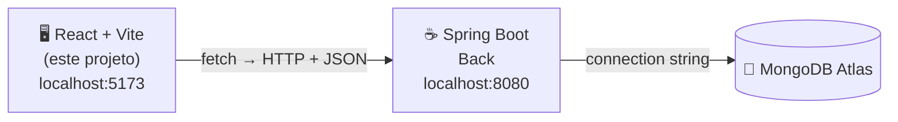
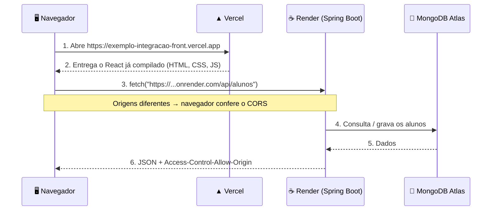

# Projeto Front (React + Vite + Spring Boot) 🔗

## 📖 Descrição

Front-end em **React** e **Vite** que faz um CRUD de **alunos** (cadastrar, listar, buscar, editar e excluir) consumindo a API do projeto [**Back**](../Back), feita em **Spring Boot** com **MongoDB Atlas**.

Nos projetos anteriores, cada projeto rodava sozinho: o Spring Boot na porta **8080** e o React na porta **5173**. Neste exemplo, os **dois rodam ao mesmo tempo, na mesma máquina, e conversam entre si**:



O painel azul da tela mostra o **status da integração** em tempo real: se o React alcança o Spring Boot e se o Spring Boot alcança o MongoDB.

## 🖼️ Capturas de Tela

| Tudo conectado | Editando um aluno |
| :---: | :---: |
|  |  |

| Erro de validação vindo do Spring Boot (400) | Back-end desligado |
| :---: | :---: |
|  |  |

| Mobile |
| :---: |
|  |

---

## 📁 Organização das pastas (importante!)

Os scripts deste projeto sobem o back-end com `cd ../Back`. Por isso os dois projetos precisam ficar **lado a lado, dentro da mesma pasta**:

```text
📁 Exemplo_Integracao
├── 📁 Back    ← Spring Boot (porta 8080)
└── 📁 Front   ← este projeto (porta 5173)
```

## ✅ Pré-requisitos

| O quê | Para quê | Como conferir |
| --- | --- | --- |
| **Node.js 20+** | Rodar o React / Vite | `node -v` |
| **JDK 17** | Rodar o Spring Boot | `java -version` |
| **MongoDB Atlas configurado no back-end** | Gravar os dados | Siga a seção *Configurando o MongoDB Atlas* do [README do back-end](../Back/README.md) |

> O Maven **não** precisa estar instalado: o back-end usa o Maven Wrapper (`mvnw`), que baixa o Maven sozinho.

---

## 🚀 Rodando os dois projetos ao mesmo tempo

### Entendendo o problema

Um terminal fica "preso" enquanto um servidor está rodando. Até agora, você abria **um** terminal e rodava **um** projeto. Agora precisamos de **dois servidores ligados ao mesmo tempo**:

| Servidor | Comando | Porta |
| --- | --- | --- |
| Back-end (Spring Boot) | `./mvnw spring-boot:run` | 8080 |
| Front-end (Vite) | `npm run dev` | 5173 |

Os dois podem rodar juntos porque usam **portas diferentes**. Cada porta é como uma "porta de entrada" separada no mesmo computador (`localhost`).

Há duas formas de fazer isso.

### Opção 1: dois terminais (para entender)

**Terminal 1: back-end**

```bash
cd Back
./mvnw spring-boot:run        # Windows: .\mvnw.cmd spring-boot:run
```

Espere aparecer `Tomcat started on port 8080`. Deixe esse terminal aberto.

**Terminal 2: front-end**

```bash
cd Front
npm install                   # só na primeira vez
npm run dev
```

Abra [http://localhost:5173](http://localhost:5173).

Funciona, mas é chato ter que abrir, organizar e fechar dois terminais toda vez. Por isso existe a opção 2.

### Opção 2: um terminal só, com o `concurrently` ⭐

O [`concurrently`](https://www.npmjs.com/package/concurrently) é um pacote do npm que **roda vários comandos ao mesmo tempo no mesmo terminal**. Ele já está instalado como dependência de desenvolvimento deste projeto.

```bash
cd Front
npm install                   # só na primeira vez

npm run dev:all               # macOS / Linux
npm run dev:all:windows       # Windows
```

A saída dos dois servidores aparece misturada no mesmo terminal, cada linha com uma etiqueta colorida dizendo de onde veio:

```text
[FRONT]   VITE v8.3.4  ready in 312 ms
[FRONT]   ➜  Local:   http://localhost:5173/
[BACK]    .   ____          _            __ _ _
[BACK]   /\\ / ___'_ __ _ _(_)_ __  __ _ \ \ \ \
[BACK]   ...
[BACK]   Tomcat started on port 8080 (http) with context path '/'
[BACK]   Started BackApplication in 4.2 seconds
```

Para **parar os dois** de uma vez: `Ctrl + C`.

> ⏱️ O Vite fica pronto em 1 segundo, mas o Spring Boot leva alguns segundos (e, na **primeira** vez, mais ainda, porque o Maven Wrapper baixa o Maven e as dependências). Enquanto isso, a tela mostra **"Back-end Spring Boot: Sem resposta"** e tenta de novo a cada 5 segundos. Quando o Spring Boot terminar de subir, a bolinha fica verde sozinha.

### Como isso está no `package.json`

```json
"scripts": {
  "dev": "vite",
  "build": "vite build",
  "lint": "oxlint",
  "preview": "vite preview",
  "back": "cd ../Back && ./mvnw spring-boot:run",
  "back:windows": "cd ..\\Back && mvnw.cmd spring-boot:run",
  "dev:all": "concurrently --names \"BACK,FRONT\" --prefix-colors \"blue,magenta\" \"npm run back\" \"npm run dev\"",
  "dev:all:windows": "concurrently --names \"BACK,FRONT\" --prefix-colors \"blue,magenta\" \"npm run back:windows\" \"npm run dev\""
}
```

| Script | O que faz |
| --- | --- |
| `back` | Entra na pasta do back-end e sobe o Spring Boot (macOS / Linux) |
| `back:windows` | O mesmo, no Windows (`mvnw.cmd` no lugar de `./mvnw`) |
| `dev` | Sobe o Vite na porta 5173 |
| `dev:all` | Roda `back` e `dev` **ao mesmo tempo** com o concurrently |
| `dev:all:windows` | O mesmo, no Windows |

Opções usadas no `concurrently`:

- `--names "BACK,FRONT"`: etiqueta de cada comando no terminal
- `--prefix-colors "blue,magenta"`: cor de cada etiqueta
- `"npm run back" "npm run dev"`: os comandos que rodam em paralelo (cada um entre aspas)

> **Por que dois scripts (um para Windows)?** No macOS/Linux o terminal executa o wrapper com `./mvnw`. No Windows, o npm usa o `cmd`, que não entende `./mvnw`: lá o arquivo certo é o `mvnw.cmd`.

Para instalar o concurrently em um projeto seu:

```bash
npm install --save-dev concurrently
```

---

## 🔌 Como o front-end se conecta ao back-end

### 1. Onde fica o endereço da API: `src/config/apiConfig.js`

```js
const URL_PADRAO = "http://localhost:8080";

const API_CONFIG = {
  BASE_URL: (import.meta.env.VITE_API_URL || URL_PADRAO).replace(/\/+$/, ""),
};
```

- **No seu computador** não precisa configurar nada: sem `VITE_API_URL`, o front usa `http://localhost:8080`.
- **No Vercel**, a variável `VITE_API_URL` aponta para a URL do back-end no Render.

### 2. Quem faz as requisições: `src/services/`

| Arquivo | Responsabilidade |
| --- | --- |
| `httpClient.js` | Função `requisicao()`: monta a URL, chama o `fetch` e trata os erros em um só lugar |
| `alunoService.js` | Uma função para cada endpoint do CRUD |
| `statusService.js` | Pergunta ao back-end se ele e o MongoDB estão no ar |

| Função (front) | Requisição | Endpoint (Spring Boot) |
| --- | --- | --- |
| `listarAlunos()` | `GET` | `/api/alunos` |
| `listarAlunos("ana")` | `GET` | `/api/alunos?nome=ana` |
| `buscarAlunoPorId(id)` | `GET` | `/api/alunos/{id}` |
| `criarAluno(aluno)` | `POST` | `/api/alunos` |
| `atualizarAluno(id, aluno)` | `PUT` | `/api/alunos/{id}` |
| `excluirAluno(id)` | `DELETE` | `/api/alunos/{id}` |
| `verificarStatus()` | `GET` | `/api/status` |

Exemplo do que acontece ao clicar em **Cadastrar aluno**:

```js
// alunoService.js
export function criarAluno(aluno) {
  return requisicao("/api/alunos", {
    method: "POST",
    body: JSON.stringify(aluno), // { nome, email, curso }
  });
}
```

```text
React (AlunoForm) → criarAluno() → fetch POST http://localhost:8080/api/alunos
                                          │
Spring Boot: AlunoController → AlunoService → AlunoRepository → MongoDB Atlas
                                          │
React ← 201 Created + JSON do aluno salvo (com o "id" gerado pelo MongoDB)
```

### 3. Como os erros do back-end chegam na tela

O formulário usa `noValidate`, então o **Spring Boot** é quem valida. Se você clicar em **Cadastrar aluno** com o nome vazio:

1. O `AlunoService` (back) lança `DadosInvalidosException`.
2. O `GlobalExceptionHandler` (back) responde **400** com `{ "mensagem": "O nome do aluno é obrigatório." }`.
3. O `httpClient.js` (front) vê que `resposta.ok` é falso, lê o campo `mensagem` e lança um `Error`.
4. O `App.jsx` mostra a mensagem na caixa vermelha (veja a captura *Erro de validação*).

### 4. CORS: por que o back-end precisa "liberar" o front

Para o navegador, `http://localhost:5173` e `http://localhost:8080` são **origens diferentes** (a porta é diferente). Por segurança, o navegador só entrega ao React a resposta de outra origem se o back-end autorizar. Essa autorização se chama **CORS**.

No back-end, isso está no `application.properties`:

```properties
app.cors.allowed-origins=http://localhost:5173,https://exemplo-integracao-front.vercel.app
```

Se o endereço do front não estiver nessa lista, o console do navegador (F12) mostra:

```text
Access to fetch at 'http://localhost:8080/api/alunos' from origin 'http://localhost:5173'
has been blocked by CORS policy
```

> É por isso que o `vite.config.js` fixa a porta em **5173** (`strictPort: true`): se o Vite subisse em outra porta (5174, por exemplo), o back-end bloquearia as requisições.

A explicação completa de CORS está no [README do back-end](../Back/README.md#-cors-por-que-o-front-precisa-de-permissão).

---

## 📂 Estrutura do Projeto

```text
📁 Front
│
├── 📁 imgs
│   └── Capturas de tela usadas neste README
│
├── 📁 public
│   └── pucminas-logo.png  (favicon)
│
├── 📁 src
│   ├── 📁 assets/images
│   │   └── pucminas-logo.png
│   │
│   ├── 🧩 components
│   │   ├── IntegrationPanel.jsx / .css
│   │   │   └── Painel azul: logo + status React → Spring Boot → MongoDB
│   │   ├── AlunoForm.jsx
│   │   │   └── Formulário de cadastro e edição
│   │   ├── AlunoList.jsx
│   │   │   └── Lista com busca, editar e excluir
│   │   └── Message.jsx
│   │       └── Caixa de mensagem de sucesso / erro
│   │
│   ├── ⚙️ config
│   │   └── apiConfig.js
│   │       └── URL do back-end (localhost:8080 ou VITE_API_URL)
│   │
│   ├── 🛠️ services
│   │   ├── httpClient.js     └── fetch + tratamento de erros
│   │   ├── alunoService.js   └── CRUD de alunos
│   │   └── statusService.js  └── Status do back-end e do MongoDB
│   │
│   ├── App.jsx / App.css
│   │   └── Estado da tela e ligação entre os componentes
│   ├── index.css
│   │   └── Reset, variáveis de cor da PUC e fundo da página
│   └── main.jsx
│
├── 📄 .env.example
│   └── Exemplo da variável VITE_API_URL (usada no Vercel)
├── 📄 vite.config.js
│   └── Porta fixa 5173
└── 📄 package.json
    └── Scripts dev, back, dev:all e dev:all:windows
```

---

## ☁️ Deploy: back-end no Render e front-end no Vercel

### Ordem recomendada

```text
1. Back-end no Render     → gera https://exemplo-integracao-back.onrender.com
2. Front-end no Vercel    → usa a URL do Render em VITE_API_URL
                          → gera https://exemplo-integracao-front.vercel.app
3. Volta ao back-end      → coloca a URL do Vercel no CORS (application.properties) e faz push
```

### 1. Back-end no Render

Siga a seção **Deploy no Render** do [README do back-end](../Back/README.md). Ao final, confira no navegador:

```text
https://exemplo-integracao-back.onrender.com/api/status
→ { "api": "online", "mongodb": "online" }
```

### 2. Front-end no Vercel

1. Suba o projeto para o GitHub.
2. No [Vercel](https://vercel.com/), clique em **Add New > Project** e importe o repositório.
3. Preencha:

| Campo | Valor |
| --- | --- |
| **Framework Preset** | `Vite` (detectado sozinho) |
| **Root Directory** | vazio se o repositório tiver só este projeto. Se tiver front e back juntos, escolha `Front` |
| **Build Command** | `npm run build` (padrão) |
| **Output Directory** | `dist` (padrão) |

4. Em **Environment Variables**, adicione:

| Key | Value |
| --- | --- |
| `VITE_API_URL` | `https://exemplo-integracao-back.onrender.com` (a **sua** URL do Render, sem `/` no final) |

5. Clique em **Deploy** e anote a URL gerada (ex.: `https://exemplo-integracao-front.vercel.app`).

> ⚠️ O Vite **"cola" o valor de `VITE_API_URL` dentro do JavaScript na hora do build**. Se você criar ou alterar a variável depois do deploy, vá em **Deployments > ⋯ > Redeploy** para ela fazer efeito.

### 3. Liberar o Vercel no CORS do back-end

No projeto **Back**, edite o `application.properties`:

```properties
app.cors.allowed-origins=http://localhost:5173,https://exemplo-integracao-front.vercel.app
```

Troque pela **sua** URL do Vercel, faça commit e push. O Render faz o deploy de novo sozinho. Pronto: abra a URL do Vercel e use o CRUD.

---

## 🌐 Como a integração funciona no Vercel e no Render



Pontos que mais confundem:

1. **O Vercel não roda o back-end.** Ele só hospeda os arquivos estáticos do React (o resultado do `npm run build`, pasta `dist`).
2. **Quem chama o Render é o navegador do usuário**, e não o Vercel. Por isso:
   - o React precisa saber a URL do Render → variável `VITE_API_URL`;
   - o Spring Boot precisa liberar a URL do Vercel → `app.cors.allowed-origins`.
3. **A connection string do MongoDB fica só no back-end.** O front nunca fala direto com o banco, então a senha nunca chega ao navegador.
4. **Ambos usam HTTPS em produção.** Uma página `https` não consegue chamar uma API `http`, então use sempre a URL `https://` do Render.
5. **Plano gratuito do Render:** a API "dorme" após 15 minutos parada. Na primeira visita, o painel fica em **"Verificando"** por até 1 minuto, enquanto o Render acorda o container.

| | No seu computador | Em produção |
| --- | --- | --- |
| Front-end | Vite em `http://localhost:5173` | Vercel em `https://...vercel.app` |
| Back-end | Spring Boot em `http://localhost:8080` | Render em `https://...onrender.com` |
| URL da API no front | padrão do `apiConfig.js` | variável `VITE_API_URL` no Vercel |
| Origem liberada no CORS | `http://localhost:5173` | `https://...vercel.app` |
| Banco | MongoDB Atlas | MongoDB Atlas (o mesmo) |

---

## 🛠️ Problemas comuns

| Sintoma | Causa provável | Solução |
| --- | --- | --- |
| Painel mostra **Back-end: Sem resposta** | Spring Boot desligado ou ainda subindo | Espere o `Started BackApplication` no terminal |
| Painel mostra **MongoDB: Sem resposta** | Connection string errada ou IP bloqueado no Atlas | Confira o `application.properties` do back-end e o **Network Access** (`0.0.0.0/0`) |
| Erro de **CORS** no console (F12) | Origem do front não liberada no back-end | Adicione a URL exata em `app.cors.allowed-origins` (sem `/` no final) |
| `npm run dev:all` diz que a pasta não existe | Projetos não estão lado a lado | Organize as pastas como em [Organização das pastas](#-organização-das-pastas-importante) |
| `'.' não é reconhecido como um comando` (Windows) | Usou `dev:all` no Windows | Use `npm run dev:all:windows` |
| `./mvnw: Permission denied` (Mac/Linux) | `mvnw` sem permissão de execução | Rode `chmod +x mvnw` dentro do back-end |
| `Port 5173 is already in use` | Outro Vite aberto | Feche o outro terminal. A porta é fixa por causa do CORS |
| No Vercel, o front chama `localhost:8080` | `VITE_API_URL` não configurada ou sem redeploy | Configure a variável e faça **Redeploy** |
| No Vercel, erro de *Mixed Content* | `VITE_API_URL` com `http://` | Use a URL `https://` do Render |

---

## 📦 Dependências

```json
"dependencies": {
  "react": "^19.2.8",
  "react-dom": "^19.2.8"
},
"devDependencies": {
  "@vitejs/plugin-react": "^6.1.1",
  "concurrently": "^9.2.4",
  "oxlint": "^1.81.0",
  "vite": "^8.3.0"
}
```

- [`concurrently`](https://www.npmjs.com/package/concurrently): roda o back-end e o front-end ao mesmo tempo, no mesmo terminal
- As requisições usam o `fetch` nativo do navegador, sem bibliotecas extras

## 🧪 Scripts

| Comando | O que faz |
| --- | --- |
| `npm run dev` | Só o front-end (porta 5173) |
| `npm run dev:all` | Back-end + front-end juntos (macOS / Linux) |
| `npm run dev:all:windows` | Back-end + front-end juntos (Windows) |
| `npm run build` | Build de produção em `dist/` |
| `npm run preview` | Testa o build localmente |
| `npm run lint` | Lint com o oxlint |

## 📄 Licença

Este projeto está licenciado sob a MIT License.
