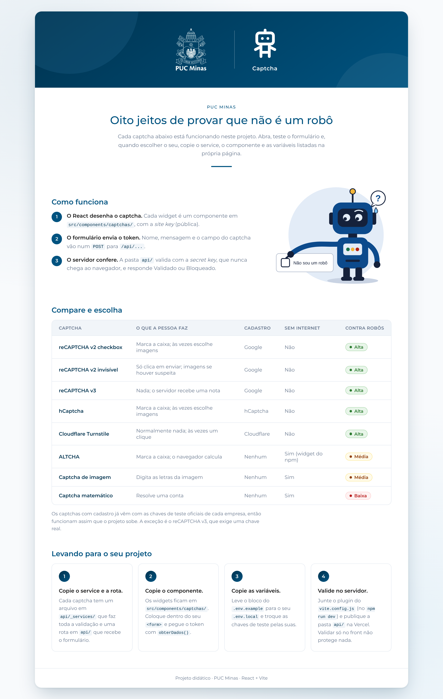
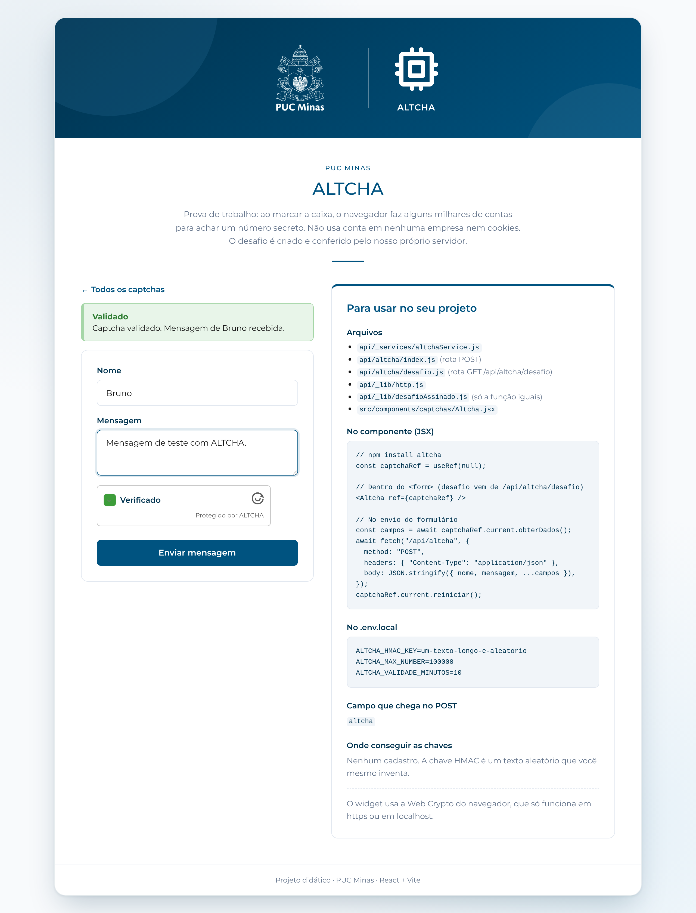
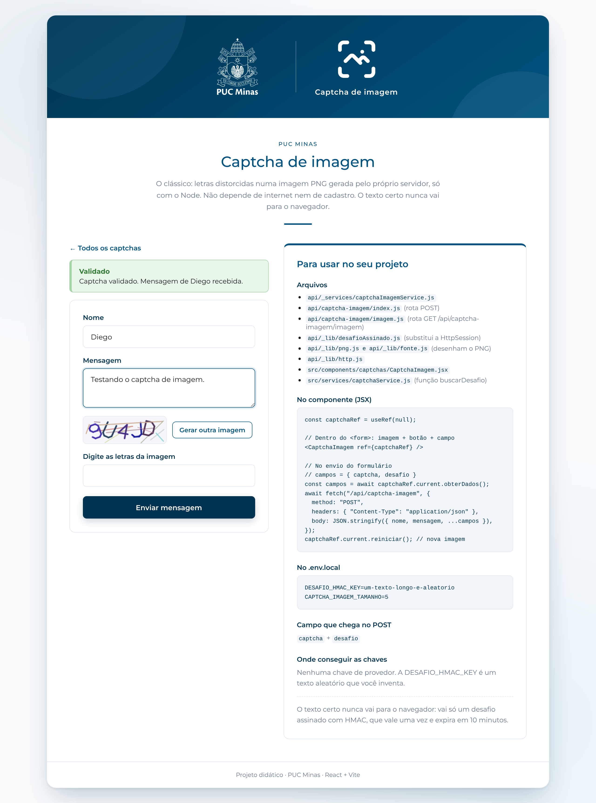
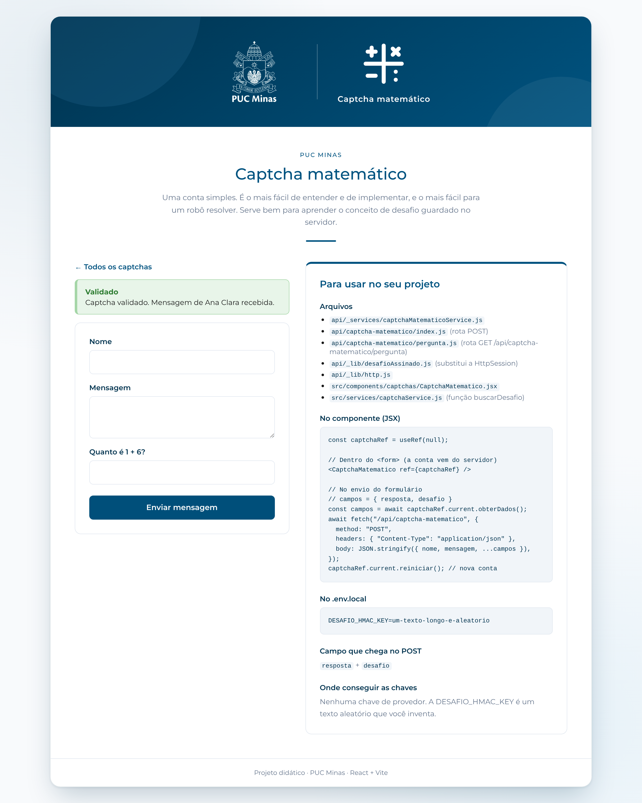
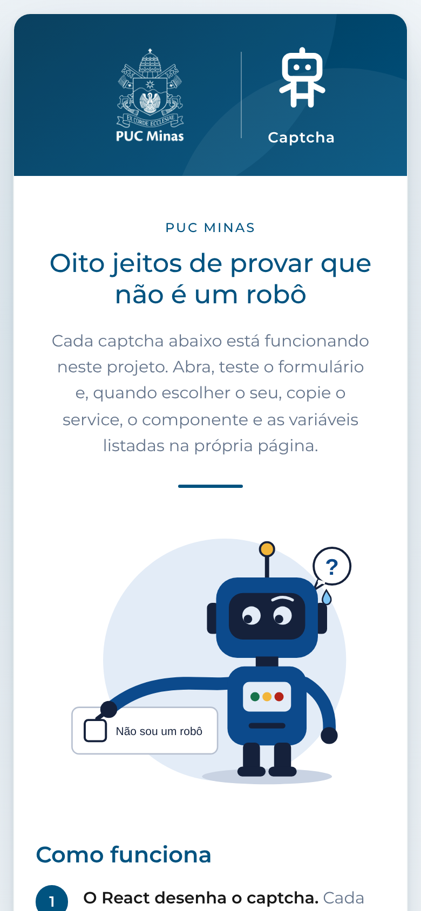

# Projeto Captcha (React + Vite) 🤖

## 📖 Descrição

O **Captcha_React** é a versão em **React** e **Vite** do projeto [Captcha (Spring Boot)](https://github.com/joaopauloaramuni/desenvolvimento-e-integracao-de-aplicacoes-web/tree/main/PROJETOS/SpringBoot/Captcha). Ele reúne, em um só lugar, **oito tipos diferentes de captcha** funcionando lado a lado. Cada captcha possui sua própria página de demonstração, seu próprio **componente** React, seu próprio **service** e sua própria **rota** no servidor, permitindo que o aluno teste todos, escolha o que melhor se encaixa no seu projeto e copie apenas os arquivos necessários.

Cada página também exibe um painel **"Para usar no seu projeto"**, com a lista de arquivos a copiar, o trecho do JSX, as variáveis do `.env.local`, o nome do campo recebido no POST e onde obter as chaves.

> 🔐 **Captcha validado só no front não protege nada.** Um robô chama a sua API direto, sem passar pela tela. Por isso este projeto tem um "back-end" na pasta `api/`: no `npm run dev` ele roda dentro do próprio Vite e, em produção, vira **Vercel Functions**. As **secret keys** ficam só lá.

## 🖼️ Capturas de Tela

| Início |
| :---: |
|  |

| ALTCHA | Captcha de imagem |
| :---: | :---: |
|  |  |

| Captcha matemático | Celular |
| :---: | :---: |
|  |  |

## 🧩 Captchas disponíveis

| Captcha | URL | O que o usuário faz | Cadastro | Funciona sem internet | Contra robôs |
|---|---|---|---|---|---|
| reCAPTCHA v2 checkbox | `/recaptcha-v2-checkbox` | Marca a caixa; às vezes escolhe imagens | Google | Não | Alta |
| reCAPTCHA v2 invisível | `/recaptcha-v2-invisivel` | Só clica em enviar | Google | Não | Alta |
| reCAPTCHA v3 | `/recaptcha-v3` | Nada; o servidor recebe uma nota | Google | Não | Alta |
| hCaptcha | `/hcaptcha` | Marca a caixa; às vezes escolhe imagens | hCaptcha | Não | Alta |
| Cloudflare Turnstile | `/turnstile` | Normalmente nada; às vezes um clique | Cloudflare | Não | Alta |
| ALTCHA | `/altcha` | Marca a caixa; o navegador calcula | Nenhum | Sim* | Média |
| Captcha de imagem | `/captcha-imagem` | Digita as letras da imagem | Nenhum | Sim | Média |
| Captcha matemático | `/captcha-matematico` | Resolve uma conta | Nenhum | Sim | Baixa |

\* O widget do ALTCHA é instalado pelo `npm` (pacote `altcha`), então vai junto no build do projeto: não depende de CDN.

### 🟦 Google reCAPTCHA v2 (checkbox)
A tradicional caixa **"Não sou um robô"**. O Google analisa o comportamento do visitante e, quando desconfia, apresenta um desafio de imagens (semáforos, faixas de pedestre, etc.). É a mesma versão utilizada no projeto SecureLoginPUC_React.

- **Campo enviado no POST:** `g-recaptcha-response`
- **Chave de teste:** sim, o Google fornece chaves que sempre aprovam.

### 🟦 Google reCAPTCHA v2 (invisível)
Mesma tecnologia do v2, mas sem a caixa de seleção. A verificação acontece quando o usuário clica no botão de enviar (`grecaptcha.execute()`), e o desafio de imagens só aparece em caso de suspeita. Um pequeno selo do reCAPTCHA fica fixo no canto da tela.

- **Campo enviado no POST:** `g-recaptcha-response`
- **Observação:** o tipo de chave é diferente do checkbox. Ao criar a chave, escolha **v2 > Selo invisível**.

### 🟦 Google reCAPTCHA v3
Não exibe nenhum desafio. O Google observa a navegação e devolve uma **pontuação (score) de 0.0 a 1.0**, onde valores próximos de 1.0 indicam um humano. Cabe ao servidor decidir a partir de qual nota a requisição é aceita (neste projeto, `0.5`). Além do `success`, o service confere o `score` e a `action`.

- **Campo enviado no POST:** `g-recaptcha-response`
- **Chave de teste:** o Google **não** oferece chave de teste para o v3. É necessário criar uma chave real com o domínio `localhost`. Sem ela, a página mostra um aviso.

### 🟩 hCaptcha
Alternativa ao reCAPTCHA v2 com foco em privacidade. Funciona de forma quase idêntica: uma caixa de seleção com desafio de imagens quando necessário. No código, mudam apenas o script, o componente, a URL de validação e o nome do campo.

- **Campo enviado no POST:** `h-captcha-response`
- **Chave de teste:** sim.

### 🟧 Cloudflare Turnstile
Na maioria das vezes o usuário não precisa fazer nada: o widget verifica o navegador sozinho e fica verde. Em alguns casos, pede um clique. É gratuito e **não exige que o site utilize a Cloudflare**.

- **Campo enviado no POST:** `cf-turnstile-response`
- **Chave de teste:** sim.

### 🟪 ALTCHA
Utiliza **prova de trabalho (proof-of-work)**. Ao marcar a caixa, o navegador precisa encontrar um número secreto testando milhares de possibilidades até gerar o mesmo hash SHA-256 enviado pelo servidor. Para uma pessoa, leva menos de um segundo; para um robô enviando milhares de formulários, o custo se torna alto. Não depende de nenhuma empresa, não usa cookies e o desafio é **criado e validado pelo nosso próprio servidor**, apenas com o `node:crypto`.

- **Campo enviado no POST:** `altcha` (texto em Base64)
- **Chave:** a chave HMAC é um texto aleatório inventado por você.
- **Observação:** o widget utiliza a Web Crypto do navegador, que só funciona em `https` ou em `localhost`.

### ⬜ Captcha de imagem
O captcha clássico: letras distorcidas desenhadas em uma imagem PNG gerada pelo próprio servidor, com linhas de ruído. No Spring, quem desenhava era o `java.awt`; aqui, uma pequena "tela" em `api/_lib/png.js` desenha as letras (uma fonte de traços em `api/_lib/fonte.js`) e gera o PNG **só com o Node** (`node:zlib`), sem nenhuma biblioteca. O texto correto **nunca vai para o navegador** e cada desafio vale uma vez só.

- **Campos enviados no POST:** `captcha` + `desafio`

### ⬜ Captcha matemático
Uma conta simples de somar, subtrair ou multiplicar. É o mais fácil de entender e implementar, sendo ideal para aprender o conceito de **desafio guardado no servidor**. Em compensação, é o mais fácil de ser resolvido por um robô.

- **Campos enviados no POST:** `resposta` + `desafio`

## 🔁 O que mudou em relação ao Spring Boot

| Spring Boot (Thymeleaf) | React + Vite |
|---|---|
| `controller/*Controller.java` | Rotas em `api/` (uma por arquivo, viram Vercel Functions) |
| `service/*Service.java` | `api/_services/*Service.js` (mesma lógica, mesmos nomes) |
| `application.properties` | `.env.local` (no dev) e Environment Variables (na Vercel) |
| `th:attr="data-sitekey=${siteKey}"` | Site key em `VITE_*`, lida por `src/config/captchaConfig.js` |
| `<script>` + `<div class="g-recaptcha">` | Componentes em `src/components/captchas/` com `render=explicit` |
| Página recarregada depois do POST | `fetch` com JSON e mensagem **Validado / Bloqueado** na mesma tela |
| `HttpSession` (captcha de imagem e matemático) | **Desafio assinado com HMAC** (`api/_lib/desafioAssinado.js`) |
| `java.awt` + `ImageIO` | `api/_lib/png.js` + `node:zlib` |
| `MessageDigest` + `Mac` (ALTCHA) | `node:crypto` (`createHash` + `createHmac`) |

### Por que não existe sessão?

Na Vercel cada requisição pode cair em uma instância diferente da função, então não há `HttpSession`. Em vez de guardar a resposta no servidor, o servidor manda ao navegador um **desafio assinado**:

```text
desafio = id . expira . HMAC(DESAFIO_HMAC_KEY, "id|expira|resposta")
```

O desafio **não contém a resposta**, só a assinatura dela. No envio, o navegador devolve o desafio e o que a pessoa digitou; o servidor recalcula o HMAC e compara. Sem a chave secreta, ninguém consegue descobrir a resposta nem forjar um desafio novo. Cada desafio expira em 10 minutos e vale **uma vez só**.

> ⚠️ A lista de desafios já usados (e a do ALTCHA) fica na memória. No `npm run dev` funciona sempre; na Vercel, vale por instância da função. Em produção de verdade, troque por um cache com expiração (ex.: Redis / Upstash), assim como o comentário do `AltchaService` do Spring já recomendava.

## 🚀 Como rodar

```bash
npm install
cp .env.example .env.local   # opcional: sem ele, valem as chaves de teste
npm run dev
```

Acesse `http://localhost:5173`. Utilize `localhost` em vez de `127.0.0.1`, pois é o domínio liberado nas chaves de teste e é considerado seguro pelo navegador, requisito do ALTCHA.

> Sem o `.env.local`, **sete dos oito captchas já funcionam** com as chaves de teste oficiais. Só o reCAPTCHA v3 precisa de uma chave real.

## 🔐 Configurando o `.env.local`

O `.env.local` guarda as variáveis de ambiente **só na sua máquina**: ele está no `.gitignore` e **não vai para o GitHub**.

1. Copie o modelo:

   ```bash
   cp .env.example .env.local
   ```

2. Preencha só o que quiser trocar (o que ficar vazio usa a chave de teste):

   ```properties
   # Google reCAPTCHA v2 - checkbox
   VITE_RECAPTCHA_V2_CHECKBOX_SITE_KEY=
   RECAPTCHA_V2_CHECKBOX_SECRET_KEY=

   # Google reCAPTCHA v2 - invisível
   VITE_RECAPTCHA_V2_INVISIVEL_SITE_KEY=
   RECAPTCHA_V2_INVISIVEL_SECRET_KEY=

   # Google reCAPTCHA v3 (não possui chave de teste)
   VITE_RECAPTCHA_V3_SITE_KEY=
   RECAPTCHA_V3_SECRET_KEY=
   # RECAPTCHA_V3_SCORE_MINIMO=0.5

   # hCaptcha
   VITE_HCAPTCHA_SITE_KEY=
   HCAPTCHA_SECRET_KEY=

   # Cloudflare Turnstile
   VITE_TURNSTILE_SITE_KEY=
   TURNSTILE_SECRET_KEY=

   # ALTCHA (a chave HMAC é um texto aleatório criado por você)
   ALTCHA_HMAC_KEY=
   # ALTCHA_MAX_NUMBER=100000
   # ALTCHA_VALIDADE_MINUTOS=10

   # Captcha de imagem e matemático (assina os desafios)
   DESAFIO_HMAC_KEY=
   # CAPTCHA_IMAGEM_TAMANHO=5
   ```

3. **Reinicie** o `npm run dev`.

> 💡 **Por que a site key tem `VITE_` e a secret key não?** Tudo que começa com `VITE_` vai **dentro do JavaScript** do navegador, e qualquer visitante consegue ler. A **site key** é pública (ela aparece no HTML de qualquer site com captcha), então pode. A **secret key** não: sem o prefixo, ela é lida **só no servidor**, pelo `vite.config.js` no `npm run dev` e pelas **Vercel Functions** da pasta `api/` em produção.

> ⚠️ A **secret key** nunca pode aparecer no front, no `.env.example` preenchido ou em um repositório público. Se uma secret key real for publicada no GitHub, gere uma nova no painel do provedor: apagar o commit não basta, pois o histórico continua acessível.

Para gerar uma chave HMAC aleatória (ALTCHA e desafios):

```bash
openssl rand -base64 48
```

### 🧪 Chaves de teste usadas por padrão

| Provedor | Site key | Secret key |
|---|---|---|
| Google reCAPTCHA v2 | `6LeIxAcTAAAAAJcZVRqyHh71UMIEGNQ_MXjiZKhI` | `6LeIxAcTAAAAAGG-vFI1TRnWxEg4jB4kFGeWtxJ-FXM` |
| hCaptcha | `10000000-ffff-ffff-ffff-000000000001` | `0x0000000000000000000000000000000000000000` |
| Cloudflare Turnstile | `1x00000000000000000000AA` | `1x0000000000000000000000000000000AA` |

Elas sempre aprovam e o widget mostra um aviso de "somente para testes". Para tirar o aviso, use as suas chaves.

## ☁️ Deploy na Vercel (variáveis de ambiente)

1. Suba o projeto para um repositório no GitHub.
2. Em [vercel.com/new](https://vercel.com/new), clique em **Import** no repositório (preset **Vite**).
3. Abra **Environment Variables** e cadastre as chaves que quiser trocar (mesmos nomes do `.env.example`), por exemplo:

   | Key | Value |
   | --- | --- |
   | `VITE_RECAPTCHA_V3_SITE_KEY` | `6Lc...` |
   | `RECAPTCHA_V3_SECRET_KEY` | `6Lc...` |
   | `ALTCHA_HMAC_KEY` | texto aleatório |
   | `DESAFIO_HMAC_KEY` | texto aleatório |

4. Clique em **Deploy**.
5. Nos painéis do Google, hCaptcha e Cloudflare, adicione o **domínio da Vercel** (ex.: `meu-projeto.vercel.app`) nos domínios permitidos de cada chave.

> As variáveis `VITE_*` entram no JavaScript **na hora do build**: se trocar alguma, faça um **Redeploy**.

O `vercel.json` manda todas as rotas que **não** começam com `/api/` para o `index.html` (para o React Router funcionar ao recarregar a página).

## ⚙️ Como funciona

```text
                         site key (VITE_*)
Navegador (React) ───────────────────────────▶ Google / hCaptcha / Cloudflare
     │   widget desenhado com render=explicit         │
     │◀──────────────────────── token ────────────────┘
     │
     └─POST /api/hcaptcha { nome, mensagem, "h-captcha-response" }─▶ vite.config.js (dev)
                                                                     ou api/hcaptcha.js (Vercel)
                                                                       │ + secret key
                                                                       ▼
                                              siteverify do provedor → { success: true }
     ◀──────────────── { sucesso: true, mensagem: "Captcha validado..." } (200)
                       { sucesso: false, mensagem: "..." }              (403)
```

Nos captchas sem provedor, o próprio servidor cria o desafio:

```text
ALTCHA:      GET /api/altcha/desafio            → { algorithm, challenge, maxnumber, salt, signature }
Imagem:      GET /api/captcha-imagem/imagem     → { imagem: "data:image/png;base64,...", desafio }
Matemático:  GET /api/captcha-matematico/pergunta → { pergunta: "Quanto é 3 + 4?", desafio }
```

### O padrão dos componentes de captcha

Todos os componentes de `src/components/captchas/` têm a mesma "interface", acessada por `ref`:

```jsx
const captchaRef = useRef(null);

<HCaptcha ref={captchaRef} siteKey={CAPTCHA_CONFIG.HCAPTCHA_SITE_KEY} />

await captchaRef.current.obterDados(); // { "h-captcha-response": "token..." }
captchaRef.current.reiniciar();        // cada token / desafio vale uma vez só
```

O `FormularioContato` usa essa interface: pede os campos do captcha, faz o `POST`, mostra **Validado** ou **Bloqueado** e reinicia o captcha. Para trocar de captcha no seu projeto, basta trocar o componente e a rota.

> Os três provedores (Google, hCaptcha e Cloudflare) são carregados com `?onload=...&render=explicit` pelo `src/utils/carregarScript.js`. Assim o script é baixado **uma vez só** e o React decide onde e quando desenhar o widget (inclusive no `StrictMode`, que monta os componentes duas vezes no dev). O reCAPTCHA v2 e o v3 usam o **mesmo script**, então convivem no mesmo site.

## 📂 Estrutura do Projeto

```text
📁 Captcha_React
│
├── 📁 api                               └── "Back-end": vira Vercel Functions
│   │
│   ├── 🎮 Rotas (equivalem aos controllers do Spring)
│   │   ├── recaptcha-v2-checkbox.js     └── POST /api/recaptcha-v2-checkbox
│   │   ├── recaptcha-v2-invisivel.js    └── POST /api/recaptcha-v2-invisivel
│   │   ├── recaptcha-v3.js              └── POST /api/recaptcha-v3 (confere a action)
│   │   ├── hcaptcha.js                  └── POST /api/hcaptcha
│   │   ├── turnstile.js                 └── POST /api/turnstile
│   │   ├── 📁 altcha
│   │   │   ├── index.js                 └── POST /api/altcha
│   │   │   └── desafio.js               └── GET  /api/altcha/desafio
│   │   ├── 📁 captcha-imagem
│   │   │   ├── index.js                 └── POST /api/captcha-imagem
│   │   │   └── imagem.js                └── GET  /api/captcha-imagem/imagem
│   │   └── 📁 captcha-matematico
│   │       ├── index.js                 └── POST /api/captcha-matematico
│   │       └── pergunta.js              └── GET  /api/captcha-matematico/pergunta
│   │
│   ├── ⚙️ _services                     └── Toda a lógica de validação de cada captcha
│   │   ├── recaptchaV2Service.js
│   │   ├── recaptchaV3Service.js
│   │   ├── hcaptchaService.js
│   │   ├── turnstileService.js
│   │   ├── altchaService.js
│   │   ├── captchaImagemService.js
│   │   └── captchaMatematicoService.js
│   │
│   ├── 🧰 _lib
│   │   ├── config.js                    └── Chaves e configurações (o "application.properties")
│   │   ├── http.js                      └── Ler JSON, responder, POST para o siteverify
│   │   ├── desafioAssinado.js           └── Desafio com HMAC (substitui a HttpSession)
│   │   ├── png.js                       └── Tela + gerador de PNG (substitui o java.awt)
│   │   └── fonte.js                     └── Letras do captcha de imagem, feitas de traços
│   │
│   └── _rotas.js                        └── Mapa endereço → rota, usado pelo vite.config.js
│
├── 📁 imgs                              └── Capturas de tela usadas neste README
├── 📁 public                            └── pucminas-logo.png (favicon)
│
├── 📁 src
│   ├── 📁 assets/images                 └── pucminas-logo.png e robo.svg
│   │
│   ├── 🧩 components
│   │   ├── PageLayout/                  └── Card com a faixa azul (logo PUC + logo do captcha)
│   │   ├── CaptchaPage/                 └── Formulário + painel "Para usar no seu projeto"
│   │   ├── FormularioContato/           └── Nome, mensagem, envio e Validado/Bloqueado
│   │   └── captchas/                    └── Um componente por captcha
│   │       ├── ReCaptchaV2.jsx          └── Checkbox e invisível
│   │       ├── ReCaptchaV3.jsx
│   │       ├── HCaptcha.jsx
│   │       ├── Turnstile.jsx
│   │       ├── Altcha.jsx               └── Web Component do pacote npm altcha
│   │       ├── CaptchaImagem.jsx
│   │       └── CaptchaMatematico.jsx
│   │
│   ├── 📄 pages                         └── Home + uma página por captcha + 404
│   ├── ⚙️ config/captchaConfig.js       └── Site keys (VITE_*) e chaves de teste
│   ├── 🛠️ services/captchaService.js    └── fetch para a pasta api/
│   ├── 🔧 utils/carregarScript.js       └── Carrega o script do provedor uma vez só
│   ├── App.jsx                          └── Rotas (React Router), mesmas URLs do Spring
│   ├── index.css
│   └── main.jsx
│
├── 📄 .env.example
├── 📄 vercel.json                       └── Rewrite do React Router (menos /api)
├── 📄 vite.config.js                    └── Atende /api/... no npm run dev
└── 📄 package.json
```

## 🛠️ Services

### recaptchaV2Service.js
Valida o token das duas versões do reCAPTCHA v2 (checkbox e invisível), que funcionam da mesma forma no servidor e mudam apenas o par de chaves. Envia o token e a secret key para `https://www.google.com/recaptcha/api/siteverify` e lê o campo `success` da resposta. Possui as funções `validarCheckbox(config, token)` e `validarInvisivel(config, token)`. Se o seu projeto usar só uma das versões, basta apagar a função e a chave da outra.

### recaptchaV3Service.js
Valida o token do reCAPTCHA v3 na mesma URL do Google, mas vai além do `success`: confere se o `score` é maior ou igual ao mínimo configurado em `RECAPTCHA_V3_SCORE_MINIMO` e se a `action` retornada é igual à usada no `grecaptcha.execute(...)` do front. Retorna `{ valido, score, motivo }`.

### hcaptchaService.js
Valida o token do hCaptcha em `https://api.hcaptcha.com/siteverify`. Envia também a site key, o que garante que o token foi gerado pelo seu próprio widget.

### turnstileService.js
Valida o token do Cloudflare Turnstile em `https://challenges.cloudflare.com/turnstile/v0/siteverify`. Envia também o IP do usuário (`remoteip`), que ajuda a Cloudflare a detectar abuso.

### altchaService.js
Cria e valida os desafios do ALTCHA sem nenhuma biblioteca no servidor. A função `criarDesafioAltcha()` sorteia um salt com prazo de validade e um número secreto, calcula o hash SHA-256 e o assina com HMAC. A função `validarAltcha(config, payload)` decodifica o Base64 enviado pelo widget e confere quatro pontos: se o prazo não expirou, se o número encontrado gera o mesmo hash, se a assinatura é válida e se o desafio ainda não foi utilizado. Usa o formato de desafio "v1" do ALTCHA, que o widget atual (pacote `altcha` v3) continua aceitando.

### captchaImagemService.js
Sorteia um texto, desenha a imagem PNG com letras de tamanhos, cores e inclinações diferentes, além de linhas de ruído, e devolve a imagem com um desafio assinado. Letras facilmente confundíveis (como `0` e `O`, `1` e `I`) foram retiradas. A função `validarCaptchaImagem(config, desafio, resposta)` compara sem diferenciar maiúsculas e minúsculas e invalida o desafio.

### captchaMatematicoService.js
Gera uma conta aleatória de soma, subtração ou multiplicação e devolve a pergunta com um desafio assinado. Na subtração, o maior número vem primeiro para o resultado nunca ser negativo.

## 🧩 Como levar um captcha para o seu projeto

1. **Service e rota:** copie o arquivo de `api/_services/`, a rota correspondente em `api/` e o `api/_lib/http.js`. Leve também o bloco do captcha que está em `api/_lib/config.js`.
2. **Componente:** copie o componente de `src/components/captchas/` (e o `src/utils/carregarScript.js`, para Google, hCaptcha e Cloudflare). Coloque dentro do seu `<form>`.
3. **Variáveis:** copie o bloco correspondente do `.env.example` para o seu `.env.local`.
4. **Envio:** no submit do formulário, pegue os campos com `captchaRef.current.obterDados()`, envie junto no `POST` e chame `captchaRef.current.reiniciar()` depois da resposta.
5. **Dev server:** junte o plugin `captchaApi(env)` ao seu `vite.config.js` (veja o deste projeto) para a rota funcionar no `npm run dev`.

O painel **"Para usar no seu projeto"** de cada página lista exatamente os arquivos daquele captcha.

> Para proteger um login de verdade, valide o captcha **na mesma rota** que confere usuário e senha, antes de consultar o banco. No SecureLoginPUC_React (sem back-end) o reCAPTCHA é conferido só no front, o que serve para estudo, mas não impede um robô de chamar a API direto.

## 📦 Dependências

```json
"dependencies": {
  "altcha": "^3.3.0",
  "react": "^19.2.8",
  "react-dom": "^19.2.8",
  "react-icons": "^5.7.0",
  "react-router-dom": "^7.18.4"
}
```

- [`altcha`](https://github.com/altcha-org/altcha): widget do ALTCHA (Web Component) com a tradução `pt-br`
- [`react-icons`](https://react-icons.github.io/react-icons/): ícones da faixa azul (Google, Cloudflare...)
- [`react-router-dom`](https://reactrouter.com/): uma URL por captcha, as mesmas do projeto Spring
- **Sem SDK dos provedores:** Google, hCaptcha e Cloudflare são carregados pelo `<script>` oficial de cada um, e a validação no servidor é um `fetch` para o `siteverify`.
- **Sem biblioteca no servidor:** SHA-256, HMAC, sorteios e PNG usam só módulos do Node (`node:crypto` e `node:zlib`).

## 🧪 Scripts

| Comando | O que faz |
| --- | --- |
| `npm run dev` | Servidor de desenvolvimento (com as rotas `/api/...`) |
| `npm run build` | Build de produção em `dist/` |
| `npm run preview` | Testa o build localmente (também atende `/api/...`) |
| `npm run lint` | Lint com o oxlint (padrão do template atual do Vite) |

## 🔗 Urls do projeto

http://localhost:5173/

http://localhost:5173/recaptcha-v2-checkbox

http://localhost:5173/recaptcha-v2-invisivel

http://localhost:5173/recaptcha-v3

http://localhost:5173/hcaptcha

http://localhost:5173/turnstile

http://localhost:5173/altcha

http://localhost:5173/captcha-imagem

http://localhost:5173/captcha-matematico

## 📚 Documentação e links úteis

### Google reCAPTCHA
- [Painel de administração (criar chaves)](https://www.google.com/recaptcha/admin)
- [reCAPTCHA v2 checkbox](https://developers.google.com/recaptcha/docs/display)
- [reCAPTCHA v2 invisível](https://developers.google.com/recaptcha/docs/invisible)
- [reCAPTCHA v3](https://developers.google.com/recaptcha/docs/v3)
- [Validação no servidor (siteverify)](https://developers.google.com/recaptcha/docs/verify)
- [FAQ e chaves de teste](https://developers.google.com/recaptcha/docs/faq)

### hCaptcha
- [Painel (criar chaves)](https://dashboard.hcaptcha.com)
- [Documentação oficial](https://docs.hcaptcha.com)

### Cloudflare Turnstile
- [Painel da Cloudflare](https://dash.cloudflare.com)
- [Documentação oficial](https://developers.cloudflare.com/turnstile/)
- [Chaves de teste](https://developers.cloudflare.com/turnstile/troubleshooting/testing/)

### ALTCHA
- [Documentação oficial](https://altcha.org/docs/)
- [Repositório no GitHub](https://github.com/altcha-org/altcha)

### React, Vite e Vercel
- [Documentação do React](https://react.dev/)
- [Documentação do Vite](https://vite.dev/)
- [Variáveis de ambiente no Vite](https://vite.dev/guide/env-and-mode)
- [React Router](https://reactrouter.com/)
- [Vercel Functions](https://vercel.com/docs/functions)

## 📄 Licença
Este projeto está licenciado sob a MIT License.
