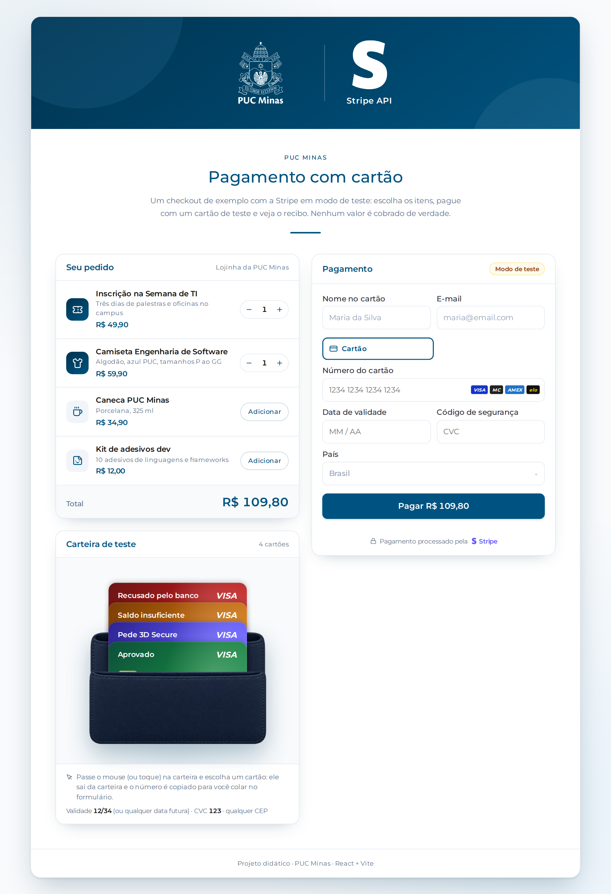
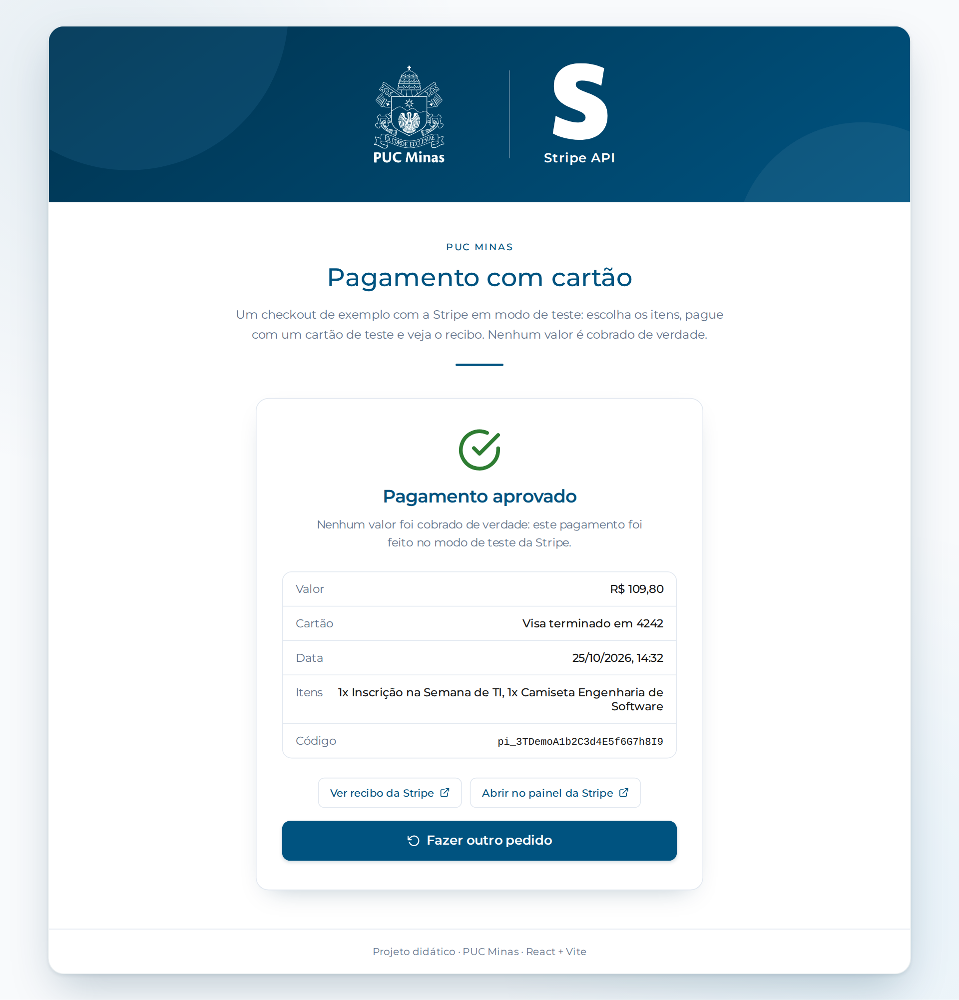
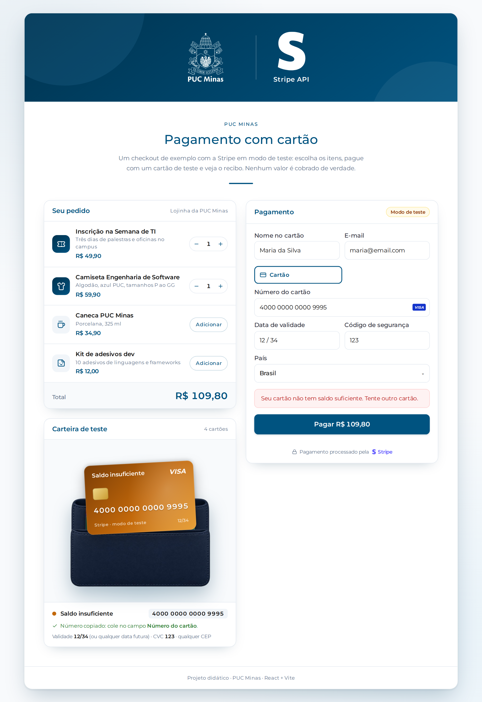
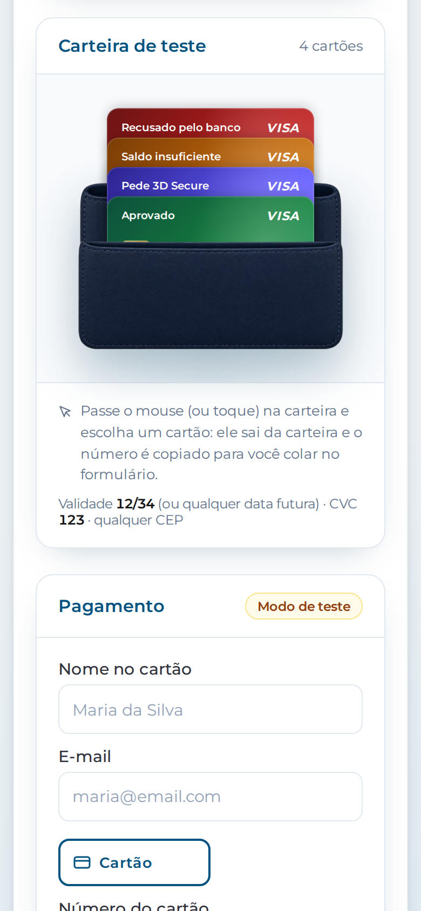

# Projeto StripeAPI_2 (React + Vite) 💳👛

## 📖 Descrição

Checkout de exemplo feito com **React** e **Vite** e a **Stripe**, em **modo de teste**: o visitante escolhe os itens de uma lojinha fictícia, **tira um cartão de teste da carteira**, paga e vê o **recibo** do pagamento. Nenhum dinheiro de verdade é movimentado.

> Esta é a versão 2 do projeto [StripeAPI](https://github.com/joaopauloaramuni/desenvolvimento-e-integracao-de-aplicacoes-web/tree/main/PROJETOS/React/StripeAPI). A novidade é a **carteira de teste**: os cartões de teste ficam guardados numa carteira e saem dela em leque, com o efeito de cartões saindo da carteira adaptado do componente `CarteiraFisica` do projeto **Meu Bolso**.

A ideia é ser um **modelo simples para reaproveitar**: se o seu projeto precisa receber pagamento (inscrição em evento, venda de produto, plano, doação...), copie as pastas indicadas em [Usando no seu projeto](#-usando-no-seu-projeto) e troque o catálogo pelos seus itens.

Recursos:

- **Carrinho** com quantidade por item e total atualizado na hora
- Formulário de cartão oficial da Stripe (**Payment Element**), em português e nas cores da PUC
- **3D Secure**: quando o banco pede autenticação, a janela abre sozinha
- **Carteira de teste**: passe o mouse (ou toque) e os cartões de teste saem da carteira em leque; clique em um e ele sai da carteira, com o número já copiado para colar no formulário
- **Recibo** com valor, cartão usado, código do pagamento, link do recibo da Stripe e link para o painel
- Mensagens de erro do cartão traduzidas pela própria Stripe ("Seu cartão foi recusado.")
- O **valor é calculado no servidor** e a **chave secreta nunca vai para o navegador**

## 🖼️ Capturas de Tela

| Checkout (carteira aberta) | Cartão escolhido |
| :---: | :---: |
|  |  |

| Pagamento aprovado | Cartão recusado |
| :---: | :---: |
|  |  |

| Celular |
| :---: |
|  |

> As capturas usam um **pagamento de demonstração** (o formulário de cartão foi reproduzido para as imagens). Com as suas chaves, aparece o formulário oficial da Stripe e os pagamentos ficam no seu painel.

## 🚀 Como rodar

```bash
npm install
cp .env.example .env.local   # depois coloque as suas chaves de teste da Stripe
npm run dev
```

Acesse `http://localhost:5173`.

> Sem o `.env.local` o projeto abre, mas no lugar do checkout aparece o passo a passo **"Configure as chaves da Stripe"**.

## 🔑 Como pegar as chaves de teste da Stripe

1. Crie uma conta grátis em [dashboard.stripe.com/register](https://dashboard.stripe.com/register).
   > Para **testar** não precisa ativar a conta, informar CNPJ nem dados bancários. Ignore os avisos de "ativar pagamentos".
2. Confira se o painel está em **modo de teste** (ou em um **sandbox**): aparece uma faixa laranja escrito *Test mode* / *Sandbox* no topo.
3. Abra [dashboard.stripe.com/test/apikeys](https://dashboard.stripe.com/test/apikeys) (**Desenvolvedores** → **Chaves de API**).
4. Copie as duas chaves:

   | Chave | Começa com | Onde é usada |
   | --- | --- | --- |
   | **Chave publicável** (*Publishable key*) | `pk_test_` | No navegador, para abrir o formulário de cartão |
   | **Chave secreta** (*Secret key*) | `sk_test_` | Só no servidor, para criar e consultar pagamentos |

> ⚠️ A chave **secreta** dá acesso total à sua conta Stripe. Nunca coloque no código, no front-end nem no GitHub.
>
> ⚠️ As duas chaves precisam ser da **mesma conta** (e do mesmo sandbox). Chaves misturadas dão erro ao confirmar o pagamento.

## 🔐 Configurando o `.env.local`

O `.env.local` guarda as variáveis de ambiente **só na sua máquina**: ele está no `.gitignore` e **não vai para o GitHub**.

1. Copie o modelo:

   ```bash
   cp .env.example .env.local
   ```

2. Preencha:

   ```properties
   VITE_STRIPE_PUBLISHABLE_KEY=pk_test_51XXXXXXXXXXXXXXXXXXXXXXXX
   STRIPE_SECRET_KEY=sk_test_51XXXXXXXXXXXXXXXXXXXXXXXX
   ```

3. **Reinicie** o `npm run dev`.

> 💡 **Por que uma chave tem `VITE_` e a outra não?** Tudo que começa com `VITE_` vai **dentro do JavaScript** do navegador. A chave **publicável** foi feita para isso: ela só abre o formulário e não consegue cobrar nem ler pagamentos. A chave **secreta**, sem o prefixo, é lida **só no servidor**: pelo `vite.config.js` no `npm run dev` e pela **Vercel Function** `api/stripe.js` em produção.
>
> O projeto **recusa chaves `sk_live_`** de propósito (é um projeto de testes). Veja [Indo para produção](#-indo-para-produção).

## 🧪 Testando o pagamento

Preencha nome e e-mail e use um destes cartões. Eles também estão na **Carteira de teste**, na tela: clique no cartão e o número é copiado; depois é só colar no campo **Número do cartão**.

| Cartão | O que acontece |
| --- | --- |
| `4242 4242 4242 4242` | ✅ Aprovado |
| `4000 0025 0000 3155` | 🔐 Pede 3D Secure: abre a janela de autenticação (clique em **Complete**) |
| `4000 0000 0000 9995` | ❌ Recusado: saldo insuficiente |
| `4000 0000 0000 0002` | ❌ Recusado pelo banco |

- **Validade:** qualquer data futura (ex.: `12/34`)
- **CVC:** quaisquer 3 dígitos (ex.: `123`)
- **CEP / país:** qualquer valor

Depois de pagar, abra [dashboard.stripe.com/test/payments](https://dashboard.stripe.com/test/payments): o pagamento aparece lá com a descrição do pedido, os itens e o nome do cliente (em **Metadados**).

> Outros cartões (Mastercard, Elo, recusas específicas...): [docs.stripe.com/testing](https://docs.stripe.com/testing).

## ☁️ Deploy na Vercel (variáveis de ambiente)

1. Suba o projeto para um repositório no GitHub.
2. Em [vercel.com/new](https://vercel.com/new), clique em **Import** no repositório (preset **Vite**).
3. Abra **Environment Variables** e cadastre:

   | Key | Value |
   | --- | --- |
   | `VITE_STRIPE_PUBLISHABLE_KEY` | `pk_test_...` |
   | `STRIPE_SECRET_KEY` | `sk_test_...` |

4. Clique em **Deploy**.

Se o projeto já estiver publicado: **Settings** → **Environment Variables** → adicione as duas (marque **Production**, **Preview** e **Development**) → **Save** → **Deployments** → três pontinhos do último deploy → **Redeploy**.

> A `VITE_STRIPE_PUBLISHABLE_KEY` entra **no build**: depois de alterá-la, é obrigatório fazer o **Redeploy**.

## 👛 Carteira de teste (cartões saindo da carteira)

O efeito é montado com **duas imagens** do mesmo tamanho (603 x 414) e os cartões HTML no meio delas:

```text
  z-index 40   cartão escolhido  → sai da carteira, à frente do bolso
  z-index 31   área do bolso     → a parte escondida dos cartões não recebe clique
  z-index 30   carteira_bolso.png (frente)
  z-index 17–20 cartões (HTML de verdade, <button>)
  z-index 1    carteira_corpo.png (fundo)
```

| Estado | O que acontece |
| --- | --- |
| Fechada | Cartões empilhados dentro da carteira; só as pontas aparecem |
| Aberta (hover, toque ou Tab) | Os cartões sobem em **leque**; cada um mostra o resultado (Aprovado, 3D Secure...) |
| Cartão escolhido | O cartão **sai da carteira** (à frente do bolso, levemente girado) e os outros voltam para dentro. O número é copiado |

- Cada cartão recebe `--i` (índice) e a carteira recebe `--n` (total): o CSS calcula o leque para **qualquer quantidade de cartões**.
- O espaço acima da carteira é **fixo**: se ele crescesse no hover, a carteira desceria embaixo do mouse e o leque "pularia".
- `isolation: isolate` na carteira faz corpo, cartões e bolso disputarem o `z-index` só entre si; por isso o cartão escolhido consegue passar à frente do bolso.
- No celular não existe hover: o toque na carteira abre/fecha o leque.
- Por que **copiar** e não preencher? O campo do cartão é um `iframe` da Stripe: por segurança, nenhum código do site consegue escrever nele.
- Os cartões, as cores (`tone`), a validade e o CVC ficam em `TEST_CARDS`, `TEST_EXPIRY` e `TEST_CVC` no `src/config/stripeConfig.js`.

O componente `Wallet` é genérico: serve para qualquer lista de cartões.

```jsx
import Wallet from "./components/Wallet/Wallet";

<Wallet selectedIndex={escolhido} label="Meus cartões">
  {cartoes.map((c, i) => (
    <button key={c.id} onClick={(e) => { e.stopPropagation(); setEscolhido(i); }}>…</button>
  ))}
</Wallet>
```

## ⚙️ Como funciona

```text
 Navegador                          Servidor (vite.config.js / api/stripe.js)        Stripe
 ─────────                          ─────────────────────────────────────────        ──────
 1. elements.submit()   (valida o cartão)
 2. POST /api/stripe { items, customer } ──▶ calcula o total com src/data/products.js
                                            POST /v1/payment_intents ───────────────▶ cria o pagamento
                        ◀── { clientSecret } ◀────────────────────────────────────── client_secret
 3. stripe.confirmPayment(clientSecret) ───────────────────────────────────────────▶ cobra o cartão
    (3D Secure, se o banco pedir)       ◀────────────────────────────────────────── aprovado / recusado
 4. GET /api/stripe?id=pi_… ──────────────▶ GET /v1/payment_intents/pi_… ──────────▶ status + recibo
                        ◀── { status, card, receiptUrl } ◀─────────────────────────
```

- **O preço nunca vem do navegador.** O navegador manda só `{ id, quantity }`; o servidor busca os preços em `src/data/products.js` (o mesmo arquivo que a tela usa para mostrar o total). Se o valor viesse do navegador, bastaria abrir o DevTools para pagar R$ 0,01.
- **O cartão nunca passa pelo seu código.** O formulário de cartão é um `iframe` da Stripe; o seu site só recebe um `pi_…` e o status.
- **O formulário abre antes do pagamento existir** (fluxo *deferred intent*): o PaymentIntent só é criado no clique em **Pagar**, já com o valor final do carrinho.
- **Quem diz se o pagamento foi aprovado é a Stripe.** Depois de confirmar, a tela consulta o pagamento pelo servidor (`GET /api/stripe`) e só então mostra o recibo.
- Valores sempre em **centavos** (`4990` = R$ 49,90), como a Stripe exige. O mínimo em reais é **R$ 0,50**.
- A API REST da Stripe é chamada com `fetch` (sem SDK): os dados vão como formulário (`metadata[itens]=...`, `payment_method_types[]=card`).
- Proteções em `api/_stripe.js`: chave secreta só no servidor, produto e quantidade validados (até **10** de cada), **10 pagamentos por minuto** e **100 por dia** por IP, timeout de **20 s** e bloqueio de chaves `live`.

## 🧩 Usando no seu projeto

Copie para o seu projeto React + Vite:

```text
api/_stripe.js                          → lógica do servidor (cria e consulta pagamentos)
api/stripe.js                           → Vercel Function
src/data/products.js                    → SEUS produtos e preços (em centavos)
src/config/stripeConfig.js              → chave publicável, idioma, cores do formulário
src/services/stripeService.js           → fetch para /api/stripe
src/components/StripeCheckout/          → componentes + CSS
src/components/Wallet/                  → efeito da carteira (opcional)
src/assets/images/carteira_*.png        → imagens da carteira (opcional)
.env.example                            → modelo das variáveis
```

Instale as dependências e junte o plugin `stripeApi(env)` ao seu `vite.config.js` (veja o deste projeto):

```bash
npm install @stripe/stripe-js @stripe/react-stripe-js react-icons
```

**Opção 1: checkout completo** (carrinho + pagamento + recibo):

```jsx
import StripeCheckout from "./components/StripeCheckout/StripeCheckout";

<StripeCheckout onPaymentSuccess={(payment) => salvarPedido(payment.id)} />
```

**Opção 2: só o formulário de pagamento** (para quem já tem o próprio carrinho):

```jsx
import StripePayment from "./components/StripeCheckout/StripePayment";
import "./components/StripeCheckout/StripeCheckout.css";

<StripePayment
  items={[{ id: "camiseta", quantity: 2 }]}   // ids do src/data/products.js
  amount={11980}                               // só para mostrar no botão (centavos)
  currency="brl"
  onSuccess={(payment) => console.log(payment.status, payment.id)}
/>

{/* opcional: a carteira com os cartões de teste */}
<TestWallet />   // import TestWallet from "./components/StripeCheckout/TestWallet";
```

Para trocar os produtos, edite `PRODUCTS` em `src/data/products.js`. O campo `icon` é só um nome; o ícone de verdade fica no mapa `ICONS` do `Cart.jsx`.

## 🏁 Indo para produção

Este projeto é um **modelo didático em modo de teste**. Antes de cobrar de verdade:

1. **Ative a conta** na Stripe (dados da empresa e conta bancária) e troque para as chaves `pk_live_` / `sk_live_`.
2. **Remova o bloqueio** de chaves live no fim de `api/_stripe.js` (o bloco com `live_key`).
3. **Use webhooks** para registrar o pedido como pago. A tela pode ser fechada antes do recibo aparecer; o evento `payment_intent.succeeded`, enviado pela Stripe ao seu servidor, sempre chega. Veja [docs.stripe.com/webhooks](https://docs.stripe.com/webhooks) e teste localmente com a [Stripe CLI](https://docs.stripe.com/stripe-cli) (`stripe listen`).
4. **Guarde os pedidos num banco de dados** (o `metadata` do PaymentIntent é um bom lugar para o id do pedido).
5. Para **Pix, boleto e carteiras digitais**, troque `payment_method_types[]=card` por `automatic_payment_methods[enabled]=true` em `api/_stripe.js`, remova `paymentMethodTypes` em `StripePayment.jsx` e ative os métodos em [dashboard.stripe.com/settings/payment_methods](https://dashboard.stripe.com/test/settings/payment_methods). O componente já trata a volta de métodos que saem do site (`?payment_intent=pi_…` na URL).

## 📂 Estrutura do Projeto

```text
📁 StripeAPI_2
│
├── 📁 api
│   ├── _stripe.js       └── Cria e consulta pagamentos na Stripe, limites e validações
│   └── stripe.js        └── Vercel Function: POST e GET /api/stripe
│
├── 📁 imgs              └── Capturas de tela usadas neste README
├── 📁 public            └── pucminas-logo.png (favicon)
│
├── 📁 src
│   ├── 📁 assets/images └── pucminas-logo.png, carteira_corpo.png, carteira_bolso.png
│   │
│   ├── 🧩 components
│   │   ├── PageLayout/             └── Card da página com a faixa azul (logo PUC + logo da Stripe)
│   │   ├── Wallet/
│   │   │   ├── Wallet.jsx          └── Carteira em camadas: cartões saindo da carteira
│   │   │   └── Wallet.css          └── Leque, cartão escolhido e estados (fechada/aberta)
│   │   └── StripeCheckout/
│   │       ├── StripeCheckout.jsx  └── Checkout completo (carrinho + pagamento + recibo)
│   │       ├── StripePayment.jsx   └── Formulário de pagamento (Elements + PaymentElement)
│   │       ├── Cart.jsx            └── Produtos, quantidades e total
│   │       ├── TestWallet.jsx      └── Carteira de teste: escolhe o cartão e copia o número
│   │       ├── PaymentResult.jsx   └── Recibo: aprovado, em processamento ou não concluído
│   │       ├── KeyMissing.jsx      └── Passo a passo quando falta a chave
│   │       ├── format.js           └── Moeda, data e bandeira do cartão
│   │       └── StripeCheckout.css
│   │
│   ├── 📦 data/products.js         └── Catálogo e cálculo do total (navegador E servidor)
│   ├── ⚙️ config/stripeConfig.js
│   ├── 🛠️ services/stripeService.js
│   ├── App.jsx
│   ├── index.css
│   └── main.jsx
│
├── 📄 .env.example
├── 📄 vite.config.js    └── Atende /api/stripe no npm run dev
└── 📄 package.json
```

## 📦 Dependências

```json
"dependencies": {
  "@stripe/react-stripe-js": "^6.12.0",
  "@stripe/stripe-js": "^9.17.0",
  "react": "^19.3.0",
  "react-dom": "^19.3.0",
  "react-icons": "^5.7.0"
}
```

- [`@stripe/stripe-js`](https://github.com/stripe/stripe-js): carrega o Stripe.js (sempre de `js.stripe.com`, como a Stripe exige)
- [`@stripe/react-stripe-js`](https://github.com/stripe/react-stripe-js): `<Elements>`, `<PaymentElement>`, `useStripe` e `useElements`
- [`react-icons`](https://react-icons.github.io/react-icons/): ícones (inclusive o logo da Stripe na faixa azul)
- Sem SDK da Stripe no servidor: a API REST é chamada com `fetch`.

## 🧪 Scripts

| Comando | O que faz |
| --- | --- |
| `npm run dev` | Servidor de desenvolvimento (com a rota `/api/stripe`) |
| `npm run build` | Build de produção em `dist/` |
| `npm run preview` | Testa o build localmente (também atende `/api/stripe`) |
| `npm run lint` | Lint com o oxlint (padrão do template atual do Vite) |

## 📄 Licença
Este projeto está licenciado sob a MIT License.
